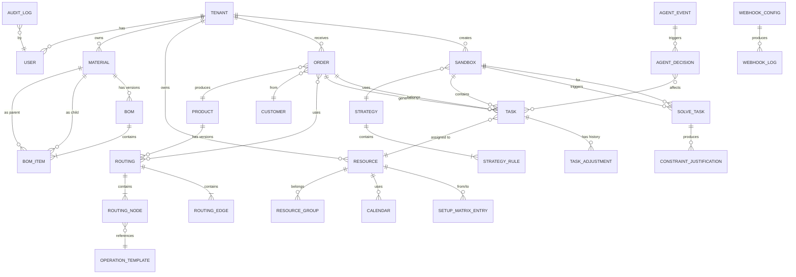

# mfg-aps-platform（衡策 APS 开源版）产品需求文档（PRD）

| 项目 | 内容 |
|---|---|
| 产品名称 | mfg-aps-platform（衡策 APS 开源版） |
| 文档版本 | v1.0-draft |
| 文档状态 | 待评审 |
| 编写日期 | 2026-11-03 |
| 目标读者 | 产品、研发、测试、架构、实施、开源社区贡献者 |
| 关联文档 | 《开源 APS 竞品调研报告》《mfg-agent-platform 集成规范》《衡策 APS 部署手册》 |

**修订历史**

| 版本 | 日期 | 作者 | 修订说明 |
|---|---|---|---|
| v0.1 | 2026-10-28 | 产品组 | 初稿，模块骨架 |
| v0.9 | 2026-11-01 | 产品组 | 补充 SMT/储能行业特性、Agent 双引擎细节 |
| v1.0-draft | 2026-11-03 | 产品组 | 整合竞品调研结论，定稿待评审 |

---

## 1. 产品概述

### 1.1 产品定位

**mfg-aps-platform（衡策 APS 开源版）** 是一款面向**离散制造行业**（优先覆盖 SMT 电子组装、储能 PACK 两大场景）的**开源智能排产系统**，定位为 ERP 与 MES 之间的「计划大脑」。

产品采用 **「传统约束求解算法 + 大模型 Agent 异常重排」双引擎架构**：
- **算法引擎**：以 Timefold Solver（Apache-2.0）为默认求解器，预留 Google OR-Tools CP-SAT 适配接口，负责大规模、多约束、可解释的生产排程求解；
- **Agent 引擎**：基于 LLM 的智能体，负责异常事件感知、自然语言约束建模、重排归因解释、对话式 what-if 分析，可独立运行，也可与 **mfg-agent-platform** 对接形成跨系统协同。

产品以 **Docker 私有化部署** 为主要交付形态，源码在 **Apache-2.0** 协议下开放，允许商业二次开发与闭源分发（需保留版权声明）。

### 1.2 目标用户与角色

| 角色 | 画像 | 核心诉求 | 使用频率 |
|---|---|---|---|
| **计划员 / 生管主管** | 中小制造企业的生产计划负责人，熟悉 Excel 排产，对算法不敏感 | 一键排产、甘特图拖拽调整、急单插单、交期预估 | 每日高频 |
| **工艺工程师** | 负责 BOM、工艺路线、换型时间维护 | 可视化建模、工序模版复用、SMT 程序/钢网管理 | 每周中频 |
| **IT / 运维** | 负责系统部署、数据集成、权限管理 | Docker 一键部署、ERP/MES 对接、日志审计 | 低频但关键 |
| **工业软件开发者** | 基于开源代码做二次开发或行业定制 | 清晰模块边界、Constraint Stream DSL、Agent 扩展点、完善 API | 持续 |
| **销售 / 客服** | 询单交期响应 | 秒级 ATP 预估 | 每日中频 |
| **车间主任 / 班组长** | 接收排产结果、反馈实际进度 | 任务下发、报工、异常上报 | 每日高频（二期） |

### 1.3 核心价值主张

1. **开源可控**：Apache-2.0 协议，源码可下载、可修改、可闭源商用，规避 AGPLv3 传染风险（对标 frePPLe 旧版 / Carbon）。
2. **中文原生**：UI、术语、报表、文档全中文，贴合国内计划员心智模型（对标 Timefold / frePPLe 的英文生态）。
3. **双引擎智能**：传统算法保证求解质量与可解释性，Agent 引擎解决「异常重排、自然语言建模、归因解释」三大痛点，形成差异化竞争力。
4. **行业深耕**：内置 SMT（拼板、Feeder、钢网、换型矩阵、MSD 湿敏管控）与储能（电芯分选、模组/PACK、BMS 测试、老化、Hi-Pot）行业模板，开箱即用。
5. **轻量部署**：Docker Compose 单机部署 ≤ 15 分钟，资源占用 ≤ 4C8G（100 工单/日规模），远低于 JVS-APS 的 Spring Cloud + Nacos 重运维栈。
6. **生态开放**：REST API + Webhook + 事件总线，可与 mfg-agent-platform、主流 ERP（用友/金蝶/SAP）、MES 双向集成。

### 1.4 差异化竞争力（对标竞品）

| 能力 | Timefold | frePPLe | JVS-APS | **衡策 APS** |
|---|---|---|---|---|
| 开源协议 | Apache-2.0 | MIT（新版）/ AGPLv3（旧版） | 需确认 | **Apache-2.0** |
| 开箱即用 | ✗ | ✓ | ✓ | **✓** |
| 中文原生 | ✗ | △ | ✓ | **✓** |
| 算法先进性 | ★★★★★ | ★★★ | ★★★ | **★★★★**（Timefold 内核 + CP-SAT 预留） |
| 需求预测 | ✗ | ✓ | ✗ | △（二期集成） |
| Agent 异常重排 | ✗ | ✗ | ✗ | **✓ 独家** |
| 自然语言约束建模 | ✗ | ✗ | ✗ | **✓ 独家** |
| 重排归因解释 | △（Justification 原始） | ✗ | ✗ | **✓ 中文归因** |
| SMT/储能行业模板 | ✗ | △ | △ | **✓** |
| 轻量部署 | N/A | 中 | 重（Spring Cloud） | **轻（Docker Compose）** |
| 与 Agent 平台对接 | ✗ | ✗ | ✗ | **✓ mfg-agent-platform** |

### 1.5 名词术语表

| 术语 | 英文 | 释义 |
|---|---|---|
| APS | Advanced Planning & Scheduling | 高级计划与排程 |
| MRP | Material Requirements Planning | 物料需求计划 |
| ATP | Available-To-Promise | 可承诺量（交期预估） |
| CTP | Capable-To-Promise | 可生产能力承诺 |
| BOM | Bill of Materials | 物料清单 |
| 工艺路线 | Routing | 产品从原料到成品的工序序列 |
| 工序模版 | Operation Template | 可复用的工序组件（含资源、物料、时长） |
| 主资源 | Primary Resource | 直接参与加工的设备/人力（如贴片机、回流焊） |
| 辅资源 | Secondary Resource | 配合主资源的工装/模具/夹具（如钢网、Feeder） |
| 换型矩阵 | Setup Matrix | 不同产品/程序之间切换所需的时间矩阵 |
| 拼板 | Panel | SMT 中多个 PCB 拼在一起生产以提升效率 |
| Feeder | Feeder | SMT 贴片机的供料器 |
| MSD | Moisture Sensitive Device | 湿敏元件，有暴露时间管控要求 |
| 电芯分选 | Cell Sorting | 储能行业中按容量/内阻对电芯进行配组 |
| PACK | Battery Pack | 储能电池包 |
| BMS | Battery Management System | 电池管理系统 |
| Hi-Pot | High Potential Test | 高压绝缘测试 |
| 冻结 | Freeze | 锁定已下达任务，重排时不可移动 |
| 锁定 | Lock | 锁定任务时间窗，重排时只能在窗内微调 |
| Justification | Constraint Justification | Timefold 输出的约束违反解释 |
| DSL | Domain Specific Language | 领域特定语言（本项目指约束描述语言） |
| Sandbox | Scenario / Sandbox | 独立的 what-if 推演场景 |

### 1.6 范围边界

**In Scope（本产品负责）**

- 基础数据管理（物料、BOM、资源、日历、客户、供应商、换型矩阵）
- 工艺路线建模（含 SMT/储能行业模板）
- 生产订单接入与管理
- 排产策略配置与求解（Timefold 引擎）
- 甘特图可视化与人工调整
- 物料约束 MRP / 齐套分析
- Agent 异常重排与自然语言交互
- REST API / Webhook / Excel 导入导出
- 用户权限、多租户、审计日志、Sandbox 场景管理

**Out of Scope（不在本产品范围，由外部系统承担）**

- 财务、成本核算（→ ERP）
- 车间现场报工、设备数据采集（→ MES / mfg-agent-platform）
- 质量追溯、SPC（→ QMS）
- 仓储管理、库位（→ WMS）
- 需求预测算法训练（二期可选集成 Prophet / LSTM，MVP 不做）
- 运输计划、车辆路径（→ TMS / VRP 专用系统）

---

## 2. 架构设计

### 2.1 总体架构（分层）

```
┌─────────────────────────────────────────────────────────────────────┐
│  L5 接入层  Web UI (Vue3 + TypeScript) / Open API / Webhook / CLI  │
├─────────────────────────────────────────────────────────────────────┤
│  L4 Agent 层（可选，可对接 mfg-agent-platform）                     │
│   · 异常感知 Agent   · NL→DSL 约束建模 Agent                        │
│   · 重排归因 Agent   · 对话式 what-if Agent                         │
│   · 交期承诺 Agent   · 数据治理 Agent                               │
├─────────────────────────────────────────────────────────────────────┤
│  L3 业务应用层（Spring Boot 3 + Java 21）                           │
│   ┌──────────┬──────────┬──────────┬──────────┬──────────┐         │
│   │ 基础数据 │ 生产工艺 │ 订单管理 │ 排产策略 │ 甘特图   │         │
│   ├──────────┼──────────┼──────────┼──────────┼──────────┤         │
│   │ MRP 齐套 │ 集成网关 │ 系统管理 │ Sandbox  │ 审计日志 │         │
│   └──────────┴──────────┴──────────┴──────────┴──────────┘         │
├─────────────────────────────────────────────────────────────────────┤
│  L2 算法引擎层（Solver Adapter 统一抽象）                           │
│   ┌────────────────────────┐  ┌────────────────────────┐           │
│   │ Timefold Solver        │  │ OR-Tools CP-SAT        │           │
│   │ (默认，Apache-2.0)     │  │ (预留，Apache-2.0)     │           │
│   │ · Constraint Stream    │  │ · Interval / NoOverlap │           │
│   │ · List Variable        │  │ · Cumulative           │           │
│   │ · Justification        │  │ · 最优性证明           │           │
│   └────────────────────────┘  └────────────────────────┘           │
│              ↑ 引擎路由 / 结果融合 / 降级策略                       │
├─────────────────────────────────────────────────────────────────────┤
│  L1 数据层  PostgreSQL 15+ / Redis 7 / MinIO（附件） / 时序库(可选)│
├─────────────────────────────────────────────────────────────────────┤
│  L0 基础设施  Docker Compose / K8s / Prometheus / Loki / Jaeger    │
└─────────────────────────────────────────────────────────────────────┘
```

### 2.2 技术选型

| 层 | 技术 | 版本 | 选型理由 |
|---|---|---|---|
| 前端 | Vue 3 + TypeScript + Vite + Element Plus + ECharts | Vue 3.4+ | 国内生态成熟，甘特图组件丰富 |
| 甘特图 | **Bryntum Scheduler**（商业）或 **vue-ganttastic**（开源）/ 自研基于 ECharts | - | Bryntum 交互最佳但收费；MVP 用 vue-ganttastic，GA 版评估 Bryntum |
| 后端 | Spring Boot 3 + Java 21 + Maven | 3.3+ / 21 LTS | Timefold 原生支持，企业级生态 |
| 求解器 | **Timefold Solver Community** | 1.35+ | Apache-2.0，元启发式完整，Constraint Stream 可解释 |
| 精确求解（预留） | Google OR-Tools CP-SAT | v9.10+ | Apache-2.0，中小规模 Job Shop 最优性证明 |
| 数据库 | PostgreSQL | 15+ | JSONB 支持动态扩展属性，开源协议友好 |
| 缓存 | Redis | 7+ | 分布式锁、求解任务队列、Session |
| 消息队列 | RabbitMQ 或 Redis Stream | - | 异步求解、事件推送、Agent 通信 |
| 对象存储 | MinIO | - | 附件（图纸、程序文件、钢网照片） |
| Agent 框架 | LangGraph4j 或 Spring AI + 自研编排 | - | 图结构 + 检查点持久化，与 mfg-agent-platform 协议对齐 |
| LLM | 可插拔：OpenAI / 通义千问 / DeepSeek / 本地 Ollama | - | 通过 Spring AI 抽象，配置化切换 |
| 部署 | Docker Compose（MVP）/ Helm Chart（GA） | - | 单机私有化优先，K8s 二期 |
| 可观测性 | Prometheus + Grafana + Loki + Jaeger | - | 开源标准栈 |
| API 文档 | SpringDoc OpenAPI 3 | - | 自动生成 Swagger UI |

### 2.3 双引擎协同架构

```
              ┌─────────────────────────────────────────────┐
              │           业务事件总线（Redis Stream）       │
              └─────────────────────────────────────────────┘
                          ↑                    ↓
   ┌──────────────────────┴──────┐    ┌────────┴──────────────────┐
   │   算法引擎（Timefold）      │    │   Agent 引擎（LLM）       │
   │  · 求解排产方案             │←──→│  · 异常事件分类           │
   │  · 输出 Justification       │    │  · NL → Constraint DSL    │
   │  · 增量重排                 │    │  · Justification → 中文   │
   │  · 多目标权衡               │    │  · what-if 对话           │
   └─────────────────────────────┘    │  · 跨系统协同（mfg-agent）│
                                      └───────────────────────────┘
                          ↑                    ↓
              ┌─────────────────────────────────────────────┐
              │        统一约束 DSL（YAML / JSON）          │
              │  · 业务人员可读   · Agent 可生成             │
              │  · 可编译为 Constraint Stream / CP-SAT      │
              └─────────────────────────────────────────────┘
```

**协同模式**

1. **Agent → 算法**：Agent 把自然语言约束（"A 客户订单必须优先"）翻译成约束 DSL，由 DSL 编译器生成 Timefold Constraint Provider 代码片段，注入求解器。
2. **算法 → Agent**：Timefold 求解完成后，把 `ConstraintJustification` 列表持久化到 DB，Agent 消费并生成中文归因（"订单 SO-001 延后 2 天，因为模具 M-01 在 3 号被 A 客户订单占用"）。
3. **异常事件驱动**：MES / mfg-agent-platform 推送异常事件（设备故障、物料延期、急单插入）→ 事件总线 → Agent 分类 → 决定是「局部微调」还是「全局重排」→ 调用算法引擎。
4. **人机协同闭环**：Agent 给出重排建议 → 计划员在甘特图确认/调整 → 调整结果反馈给 Agent 作为强化学习样本（二期）。

### 2.4 与 mfg-agent-platform 集成架构

mfg-agent-platform 是衡策体系的「工业 Agent 中台」，负责设备数据采集、异常预警、工艺知识问答等。APS 与其集成点：

| 集成方向 | 协议 | 数据内容 | 频率 |
|---|---|---|---|
| mfg-agent → APS | Webhook / MQTT | 设备状态变更、故障事件、实际报工、物料消耗 | 实时 |
| APS → mfg-agent | REST API | 排产任务下发、计划变更通知、冻结任务列表 | 实时 |
| 双向 | Redis Stream / Kafka | 异常事件、Agent 协作消息 | 实时 |
| mfg-agent → APS | gRPC（二期） | Agent 间直接调用（A2A 协议） | 按需 |

**集成契约**：APS 暴露 `/api/v1/integration/agent/*` 系列端点，mfg-agent-platform 通过标准 REST + Webhook 接入，不强制依赖特定 Agent 框架。

### 2.5 部署架构

**MVP：Docker Compose 单机部署**

```yaml
services:
  postgres:     # 主数据库
  redis:        # 缓存 + 消息
  minio:        # 附件存储
  aps-backend:  # Spring Boot 应用（含 Timefold）
  aps-frontend: # Nginx 托管 Vue 构建产物
  aps-agent:    # Agent 服务（可选，独立容器）
  prometheus:   # 监控（可选）
  grafana:      # 看板（可选）
```

**资源基线**

| 规模 | 工单/日 | CPU | 内存 | 磁盘 |
|---|---|---|---|---|
| 小型 | < 100 | 4C | 8G | 100G SSD |
| 中型 | 100-500 | 8C | 16G | 200G SSD |
| 大型 | 500-2000 | 16C | 32G | 500G SSD |

**GA：Helm Chart + K8s**，支持 HPA、多副本、蓝绿发布。

### 2.6 目录结构规范（后端）

```
mfg-aps-platform/
├── aps-common/              # 公共工具、异常、常量
├── aps-domain/              # 领域模型（Entity / VO / DTO）
├── aps-infrastructure/      # 持久化、缓存、MQ、外部集成
├── aps-solver/              # 算法引擎层
│   ├── solver-api/          # SolverAdapter 抽象接口
│   ├── solver-timefold/     # Timefold 实现
│   ├── solver-ortools/      # OR-Tools 实现（预留）
│   └── solver-dsl/          # 约束 DSL 解析与代码生成
├── aps-agent/               # Agent 引擎层（可独立部署）
│   ├── agent-core/          # Agent 编排、Prompt 管理
│   ├── agent-tools/         # Tool 定义（调用 APS API）
│   └── agent-mcp/           # MCP Server 适配（对接 mfg-agent-platform）
├── aps-service/             # 业务服务层
├── aps-web/                 # Controller / REST API
├── aps-admin/               # 启动入口 + 配置
├── aps-frontend/            # Vue3 前端
├── deploy/                  # Docker Compose / Helm / SQL 初始化
└── docs/                    # 文档
```

---

## 3. 核心业务流程

### 3.1 主排产流程（订单接入 → 求解 → 发布）

```
[ERP/手工] 销售订单 ──┐
                     ├──→ 订单池 ──→ 齐套分析 ──→ 排产策略选择 ──→ 求解任务提交
[手工] 生产订单 ──────┘         │                       │
                              缺料?                   Timefold 求解
                                │                       │
                          ┌─────┴─────┐           ┌─────┴─────┐
                          │ 是        │ 否        │ 成功      │ 失败
                          ↓           ↓           ↓           ↓
                    生成补料建议   进入排产池   排产方案    降级/告警
                                                  │
                                                  ↓
                                        Justification 持久化
                                                  │
                                                  ↓
                                        甘特图预览 + 冲突检测
                                                  │
                                          ┌───────┴───────┐
                                          │ 计划员确认    │ 调整
                                          ↓               ↓
                                       计划发布      人工干预（拖拽/锁定/冻结）
                                          │               │
                                          ↓               ↓
                                    下发 MES / 通知    重新求解（增量）
```

**关键节点 SLA**

| 节点 | 目标耗时 | 说明 |
|---|---|---|
| 订单接入 → 齐套分析 | < 5s | 100 订单规模 |
| 齐套分析 → 求解提交 | < 1s | 策略匹配 |
| Timefold 求解 | < 60s | 500 工单 / 50 资源规模，可配置超时 |
| 求解 → 甘特图渲染 | < 3s | 前端渲染 |
| 计划发布 → MES 下发 | < 10s | 异步 Webhook |

### 3.2 异常重排流程（Agent 驱动）

```
[异常源] 设备故障 / 物料延期 / 急单插入 / 质量异常 / 人员缺勤
            │
            ↓
    事件总线（Redis Stream）
            │
            ↓
    Agent 异常感知（分类 + 影响评估）
            │
    ┌───────┴───────┐
    │ 局部影响      │ 全局影响
    ↓               ↓
  微调建议      全局重排建议
    │               │
    ↓               ↓
  推送计划员     触发 Timefold 增量求解（冻结已开工任务）
    │               │
    └───────┬───────┘
            ↓
      甘特图高亮变更 + Agent 中文归因
            ↓
      计划员确认 / 驳回 / 手动调整
            ↓
      ┌─────┴─────┐
      │ 确认      │ 驳回
      ↓           ↓
   发布新计划   记录反馈（Agent 学习样本）
      ↓
   通知 MES / 受影响订单客户
```

**Agent 决策矩阵**

| 异常类型 | 影响范围 | Agent 动作 | 是否自动执行 |
|---|---|---|---|
| 单台设备故障 < 2h | 局部 | 建议顺延后续任务 | 否，需计划员确认 |
| 单台设备故障 > 2h | 全局 | 触发重排，迁移任务至备用资源 | 否，需确认 |
| 物料延期 < 4h | 局部 | 调整工序顺序，先做有料订单 | 是（可配置） |
| 物料延期 > 4h | 全局 | 重排 + 生成补料建议 | 否 |
| 急单插入（VIP 客户） | 全局 | 重排 + 影响分析（哪些订单延期） | 否 |
| 质量异常（批次报废） | 局部 | 生成补产订单 + 局部重排 | 否 |
| 人员缺勤 | 局部 | 调整班次 / 跨线支援建议 | 否 |

### 3.3 交期预估（ATP）流程

```
[销售询单] 产品 + 数量 + 期望交期
            ↓
      产能预排（Timefold 构造启发式，< 1s）
            ↓
      ┌─────┴─────┐
      │ 可满足    │ 不可满足
      ↓           ↓
   返回最早交期  返回最早交期 + 瓶颈资源 + 建议（加急/外协/拆单）
      ↓
   销售确认 → 转为正式订单
```

**SLA**：P95 < 2s（500 在制工单规模）

### 3.4 齐套分析与物料约束流程

```
[排产前] 订单池
            ↓
      BOM 多级展开
            ↓
      库存 / 在途 / 安全库存 比对
            ↓
      ┌─────┴─────┐
      │ 齐套      │ 缺料
      ↓           ↓
   进入排产池   缺料明细
                  ↓
            ┌─────┴─────┐
            │ 采购件    │ 自制件
            ↓           ↓
         按提前期推迟  自动生成补充生产订单
         生产开始时间  进入下一轮齐套分析
```

### 3.5 人工干预与甘特图调整流程

```
[甘特图] 计划员拖拽任务
            ↓
      前端实时校验（工序依赖 / 资源冲突 / 日历）
            ↓
      ┌─────┴─────┐
      │ 可行      │ 不可行
      ↓           ↓
   本地更新    高亮冲突 + 提示原因
      ↓
   触发增量重排（可选，仅调整受影响任务）
      ↓
   保存为新版本计划（支持回滚）
```

---

## 4. 分模块详细需求

> **功能点编号规范**：FR-{模块}-{序号}
> 模块代码：MD（基础数据）、PR（生产工艺）、OM（订单管理）、SS（排产策略）、SE（排产引擎）、AG（Agent）、GT（甘特图）、MRP（物料约束）、INT（集成）、SYS（系统管理）
> 每个功能点包含：**功能描述 / 业务规则 / 输入 / 输出 / 异常场景处理**

### 4.1 基础数据模块（MD）

#### FR-MD-001 物料管理

**功能描述**：维护成品、半成品、原材料、辅料等物料主数据，支持扩展属性与分类管理。

**业务规则**
- BR-MD-001-01：物料编码全局唯一，支持「分类前缀 + 流水号」自动生成（如 `MAT-PCB-00001`）。
- BR-MD-001-02：物料类型枚举：`FINISHED`（成品）、`SEMI`（半成品）、`RAW`（原材料）、`AUX`（辅料）、`PACK`（包材）。
- BR-MD-001-03：SMT 行业物料需额外维护：MSD 等级（Level 1-6）、暴露时间上限（小时）、烘烤时长、拼板数（panel size）。
- BR-MD-001-04：储能行业物料需额外维护：电芯型号、标称容量（Ah）、标称电压（V）、分选档位规则。
- BR-MD-001-05：物料可设置「安全库存」「最小订购量 MOQ」「采购提前期」「默认供应商」。
- BR-MD-001-06：物料支持「替代料」关系，含优先级与替代比例（1:1 / 1:N）。
- BR-MD-001-07：删除物料前必须校验：无 BOM 引用、无在制订单、无库存余额，否则拒绝删除（软删除）。
- BR-MD-001-08：物料支持批量导入（Excel 模板），单次 ≤ 5000 行，失败行返回错误明细。

**输入**
- 字段：`code`（编码）、`name`、`type`、`spec`（规格）、`unit`、`category`、`safetyStock`、`moq`、`leadTimeDays`、`defaultSupplierId`、`extAttrs`（JSONB 扩展属性）、`industryAttrs`（行业专属属性 JSONB）
- API：`POST /api/v1/materials`、`PUT /api/v1/materials/{id}`、`POST /api/v1/materials/import`

**输出**
- 物料实体（含 ID、创建时间、版本号）
- 导入结果：`{success: n, failed: m, errors: [{row, field, message}]}`

**异常场景处理**
| 异常 | 处理 |
|---|---|
| 编码重复 | 返回 409，提示已存在的物料 ID |
| 必填字段缺失 | 返回 400，字段级错误信息 |
| 导入文件格式错误 | 返回 400，提示模板下载链接 |
| 删除被引用物料 | 返回 422，列出引用来源（BOM / 订单 / 库存） |
| MSD 等级与暴露时间矛盾 | 前端校验拦截，后端二次校验 |

---

#### FR-MD-002 BOM 管理

**功能描述**：维护多级物料清单，支持可视化树形编辑、版本管理、替代料、损耗率。

**业务规则**
- BR-MD-002-01：BOM 必须指定「父件」「版本」「生效日期」「失效日期（可选）」。
- BR-MD-002-02：同一父件同一时间只能有一个「生效中」版本，新版本生效时旧版本自动失效。
- BR-MD-002-03：BOM 层级 ≤ 20 级，循环引用必须检测并拒绝（A→B→A）。
- BR-MD-002-04：子件字段：`materialId`、`qtyPerUnit`（单件用量）、`scrapRate`（损耗率 %）、`position`（位号，SMT 专用）、`substitutes`（替代料列表，含优先级）。
- BR-MD-002-05：SMT 行业 BOM 需支持「拼板 BOM」：一个 panel 含 N 个相同或不同 board，每个 board 有独立子件清单。
- BR-MD-002-06：BOM 支持「 phantom 」（虚拟件）：不入库、不采购，仅用于工艺分解。
- BR-MD-002-07：BOM 变更需记录审计日志（谁、何时、改了什么），支持版本对比（diff）。
- BR-MD-002-08：BOM 导入支持 Excel（模板含层级缩进）与 JSON 两种格式。

**输入**
- 字段：`parentMaterialId`、`version`、`effectiveDate`、`expiryDate`、`items: [{materialId, qtyPerUnit, scrapRate, position, substitutes}]`、`isPanel`、`panelSize`
- API：`POST /api/v1/boms`、`PUT /api/v1/boms/{id}`、`GET /api/v1/boms/{id}/tree`、`POST /api/v1/boms/{id}/activate`

**输出**
- BOM 实体 + 树形结构（前端渲染用）
- 版本对比结果：`{added: [], removed: [], modified: []}`

**异常场景处理**
| 异常 | 处理 |
|---|---|
| 循环引用 | 返回 422，列出循环路径 |
| 父件不存在 | 返回 404 |
| 生效日期早于当前日期 | 警告但允许（历史 BOM 补录） |
| 激活版本冲突 | 返回 409，提示当前生效版本 |
| 子件含已停购物料 | 警告，允许保存但标记 |

---

#### FR-MD-003 资源管理（主资源 / 辅资源）

**功能描述**：维护设备、人力、工装、模具等资源，支持资源组、产能定义、维护计划。

**业务规则**
- BR-MD-003-01：资源分类：`PRIMARY`（主资源：贴片机、回流焊、CNC、装配线）、`SECONDARY`（辅资源：钢网、Feeder、模具、夹具）、`HUMAN`（人力）、`TOOL`（工具）。
- BR-MD-003-02：产能定义三种模式（互斥）：
  - `UNIT_PER_HOUR`：单位时间产量（如 1000 pcs/h）
  - `SECONDS_PER_UNIT`：单件耗时（如 30s/pcs）
  - `BATCH_SECONDS`：批次耗时（如 每批 3600s，批容量 100）
- BR-MD-003-03：资源支持「效率系数」（0.5-1.5），实际产能 = 理论产能 × 效率系数。
- BR-MD-003-04：资源支持「可用日历」引用（见 FR-MD-004），默认 7×24 或自定义班次。
- BR-MD-003-05：辅资源需维护「安装时长」「拆卸时长」，排产时自动计入换型时间。
- BR-MD-003-06：SMT 贴片机需额外维护：支持 Feeder 槽位数、可生产的产品类型（0402/0603/QFN 等）、程序容量。
- BR-MD-003-07：资源支持「维护计划」：周期性保养（每周/每月/每 N 小时），维护窗口内不可排产。
- BR-MD-003-08：资源删除前校验：无在制任务、无未来排产任务，否则拒绝。
- BR-MD-003-09：资源支持「资源组」：同组资源可互换（如 3 台相同型号贴片机），排产时作为整体产能池。

**输入**
- 字段：`code`、`name`、`type`、`groupId`、`capacityMode`、`capacityValue`、`efficiency`、`calendarId`、`setupTime`、`teardownTime`、`maintenancePlan`、`industryAttrs`
- API：`POST /api/v1/resources`、`GET /api/v1/resources?type=PRIMARY`、`POST /api/v1/resources/{id}/maintenance`

**输出**
- 资源实体 + 资源组树 + 产能快照

**异常场景处理**
| 异常 | 处理 |
|---|---|
| 资源编码重复 | 409 |
| 产能模式与值不匹配 | 400，字段级校验 |
| 维护窗口与已排产任务冲突 | 返回冲突任务列表，要求先调整 |
| 删除被引用资源 | 422，列出引用来源 |
| 效率系数超出范围 | 400 |

---

#### FR-MD-004 工作日历

**功能描述**：定义资源/工厂的工作时间、班次、节假日、维护窗口。

**业务规则**
- BR-MD-004-01：日历类型：`FACTORY`（全厂）、`RESOURCE`（单资源）、`SHIFT`（班次模板）。
- BR-MD-004-02：班次支持：白班（08:00-17:00）、夜班（20:00-06:00）、三班倒（08-16/16-24/00-08）、自定义。
- BR-MD-004-03：节假日支持「法定节假日」「公司自定义」「调休」。
- BR-MD-004-04：日历支持「生效日期范围」，历史日历不可修改（审计要求）。
- BR-MD-004-05：资源日历优先级：资源专属 > 资源组 > 全厂默认。
- BR-MD-004-06：日历变更需提前 N 天（可配置，默认 7 天）生效，避免影响已排产计划。

**输入**
- 字段：`name`、`type`、`shifts: [{startTime, endTime, daysOfWeek}]`、`holidays: [{date, name}]`、`effectiveFrom`、`effectiveTo`
- API：`POST /api/v1/calendars`、`GET /api/v1/calendars/{id}/available?from=&to=`

**输出**
- 日历实体 + 指定时间范围内的「可用工时」列表

**异常场景处理**
| 异常 | 处理 |
|---|---|
| 班次时间重叠 | 400 |
| 生效期冲突（同类型日历） | 409 |
| 修改历史日历 | 403，提示只能新建版本 |
| 日历删除被资源引用 | 422 |

---

#### FR-MD-005 客户与供应商

**功能描述**：维护客户与供应商主数据，支持优先级、交期承诺规则、供应商提前期。

**业务规则**
- BR-MD-005-01：客户优先级：`VIP`（最高）、`NORMAL`、`LOW`，影响排产权重。
- BR-MD-005-02：客户可配置「默认交期承诺规则」：标准 LT、加急 LT、是否允许拆单。
- BR-MD-005-03：供应商维护「采购提前期」「MOQ」「到货日历」「质量等级」。
- BR-MD-005-04：客户/供应商支持「黑名单」：黑名单客户订单自动拒绝，黑名单供应商不参与 MRP 推荐。

**输入 / 输出**：标准 CRUD API，字段含 `code`、`name`、`priority`、`leadTimeDays`、`paymentTerms`、`blacklisted`。

**异常场景处理**：编码重复 409；删除有历史订单的客户 → 软删除 + 标记。

---

#### FR-MD-006 换型矩阵（SMT / 储能专用）

**功能描述**：定义不同产品/程序/物料之间切换所需的时间，是 SMT 行业排产的核心约束。

**业务规则**
- BR-MD-006-01：换型矩阵维度：`FROM_PRODUCT` → `TO_PRODUCT`，或 `FROM_PROGRAM` → `TO_PROGRAM`。
- BR-MD-006-02：换型时间组成：程序切换（分钟）+ 钢网更换（分钟）+ Feeder 换料（分钟/槽位）+ 炉温曲线调整（分钟，回流焊）。
- BR-MD-006-03：支持「同系列换型」与「跨系列换型」差异时间（如同系列 10min，跨系列 40min）。
- BR-MD-006-04：换型矩阵支持「默认值」+ 「特例覆盖」：未配置的产品对使用默认换型时间。
- BR-MD-006-05：储能行业：电芯分选档位切换、模组工装更换、BMS 程序烧录时间需单独建模。
- BR-MD-006-06：换型矩阵可批量导入（Excel 矩阵格式）。

**输入**
- 字段：`fromProductId`、`toProductId`、`setupMinutes`、`components: [{type, minutes}]`、`resourceId`（可选，特定设备）
- API：`POST /api/v1/setup-matrix`、`GET /api/v1/setup-matrix?from=&to=`

**输出**：换型时间（分钟），供 Timefold 约束使用。

**异常场景处理**：矩阵条目重复 → 覆盖 + 审计；引用不存在的产品 → 404。

---

### 4.2 生产工艺模块（PR）

#### FR-PR-001 工序模版

**功能描述**：可复用的工序组件，定义工序所需资源、物料、时长、前后关系。

**业务规则**
- BR-PR-001-01：工序模版字段：`code`、`name`、`primaryResourceId`（或资源组）、`secondaryResourceIds`、`inputMaterialIds`、`outputMaterialId`、`standardSeconds`、`setupSeconds`、`teardownSeconds`。
- BR-PR-001-02：工序模版支持「参数化」：时长、资源可在引用时覆盖（如不同产品共用「贴片」模版，但时长不同）。
- BR-PR-001-03：SMT 典型工序模版：锡膏印刷、SPI 检测、贴片（高速机/泛用机）、回流焊、AOI 检测、分板。
- BR-PR-001-04：储能典型工序模版：电芯分选、模组堆叠、激光焊接、BMS 装配、PACK 装配、老化测试、Hi-Pot 测试、气密性测试。
- BR-PR-001-05：工序模版版本管理：修改生成新版本，旧版本仍可被历史工艺路线引用。

**输入 / 输出**：标准 CRUD + 版本管理 API。

**异常场景处理**：删除被工艺路线引用的模版 → 422；资源不存在 → 404。

---

#### FR-PR-002 工艺路线

**功能描述**：可视化拖拽式工艺路线设计器，定义工序顺序、串并行关系、前后间隔时长。

**业务规则**
- BR-PR-002-01：工艺路线由「工序节点」+ 「连线」组成 DAG（有向无环图），必须检测环并拒绝。
- BR-PR-002-02：工序节点可引用「工序模版」或「自定义工序」。
- BR-PR-002-03：连线支持「完成-开始 FS」「开始-开始 SS」「完成-完成 FF」三种依赖类型，含延迟时间（lag）。
- BR-PR-002-04：支持「并行工序」：多个工序同时开始，全部完成后进入下一工序。
- BR-PR-002-05：支持「可选工序」：标记为 optional，排产时可根据资源可用性跳过。
- BR-PR-002-06：工艺路线绑定「产品」+ 「版本」+ 「生效日期」。
- BR-PR-002-07：SMT 拼板工艺：路线需标记「拼板数」，排产时按 panel 而非 board 计算产能。
- BR-PR-002-08：工艺路线导入：支持 JSON（含节点/边）与 Excel（缩进表示层级）。

**输入**
- 字段：`productId`、`version`、`nodes: [{id, templateId, overrides, position}]`、`edges: [{from, to, type, lagMinutes}]`、`isPanel`、`panelSize`
- API：`POST /api/v1/routings`、`PUT /api/v1/routings/{id}`、`GET /api/v1/routings/{id}/graph`

**输出**：工艺路线实体 + DAG 图（前端渲染）+ 工序列表（供求解器使用）。

**异常场景处理**
| 异常 | 处理 |
|---|---|
| DAG 含环 | 422，列出环路径 |
| 孤立节点 | 警告，允许保存 |
| 引用不存在模版 | 404 |
| 版本冲突 | 409 |

---

#### FR-PR-003 SMT 拼板与程序管理

**功能描述**：管理 SMT 拼板方案、贴片程序、钢网、Feeder 配置。

**业务规则**
- BR-PR-003-01：拼板方案：`panelSize`（如 2×4）、`boardSize`、`拼板方式`（V-Cut / Stamp Hole）。
- BR-PR-003-02：贴片程序：`programId`、`machineId`、`feederSlots: [{slot, materialId, orientation}]`、`cycleTime`。
- BR-PR-003-03：钢网：`stencilId`、`thickness`、`apertureRatio`、`lifeCount`（使用寿命次数）、`currentCount`。
- BR-PR-003-04：Feeder 管理：`feederId`、`type`（8mm/12mm/16mm）、`capacity`（盘装数量）、`currentQty`。
- BR-PR-003-05：排产约束：同一台贴片机同一时段只能装载一个程序；程序切换需计入换型时间。
- BR-PR-003-06：钢网寿命预警：`currentCount` 达到 `lifeCount × 80%` 时触发维护提醒。

**输入 / 输出**：CRUD API + 寿命预警 Webhook。

**异常场景处理**：Feeder 槽位冲突（同一物料占多槽）→ 警告；钢网寿命耗尽 → 强制锁定，不可排产。

---

#### FR-PR-004 储能电芯分选与 PACK 工艺

**功能描述**：储能行业专属工艺建模，含电芯分选规则、模组配组、PACK 装配序列。

**业务规则**
- BR-PR-004-01：电芯分选规则：按容量（Ah）、内阻（mΩ）、电压（V）三参数分档，档位规则可配置（如 容量 ±0.5% 为同档）。
- BR-PR-004-02：模组配组：一个模组含 N 个电芯（如 12 串），必须同档位；配组方案由 Agent 推荐或人工指定。
- BR-PR-004-03：PACK 装配序列：模组堆叠 → 激光焊接 → BMS 装配 → 箱体封装 → 老化 → Hi-Pot → 气密性 → 下线检测。
- BR-PR-004-04：老化工序特殊约束：老化柜容量有限（如 20 个 PACK/柜），老化时长固定（如 24h），排产时需考虑老化柜周转。
- BR-PR-004-05：Hi-Pot 测试需「安全资质」人员操作，资源约束含人员资质校验。

**输入 / 输出**：分选规则 CRUD、配组方案 API、工艺路线扩展字段。

**异常场景处理**：电芯档位不足 → 生成补料建议；老化柜容量不足 → 排队 + 预警。

---

### 4.3 订单管理模块（OM）

#### FR-OM-001 销售订单 / 生产订单接入

**功能描述**：接收 ERP 销售订单或手工创建生产订单，进入订单池等待排产。

**业务规则**
- BR-OM-001-01：订单来源：`ERP_SYNC`（自动同步）、`MANUAL`（手工创建）、`AGENT`（Agent 生成，如补产订单）。
- BR-OM-001-02：订单字段：`orderNo`、`productId`、`qty`、`dueDate`、`priority`、`customerId`、`routingId`（可指定，否则用默认生效版本）、`remark`。
- BR-OM-001-03：订单状态机：`DRAFT` → `CONFIRMED` → `SCHEDULED` → `RELEASED` → `IN_PROGRESS` → `COMPLETED` / `CANCELLED`。
- BR-OM-001-04：订单确认前必须校验：产品存在、BOM 生效、工艺路线生效、客户未黑名单。
- BR-OM-001-05：订单支持「拆单」：大订单拆为多个子订单（不同交期 / 不同产线）。
- BR-OM-001-06：订单支持「合单」：多个小订单合并生产（同产品、同交期、拼板优化）。
- BR-OM-001-07：ERP 同步支持「中间表」+ 「REST API」+ 「Webhook」三种模式，增量同步（按 `updateTime`）。

**输入**
- 字段：见 BR-OM-001-02
- API：`POST /api/v1/orders`、`POST /api/v1/orders/batch`、`PUT /api/v1/orders/{id}/confirm`、`POST /api/v1/orders/{id}/split`

**输出**：订单实体 + 状态变更事件（推送事件总线）。

**异常场景处理**
| 异常 | 处理 |
|---|---|
| 产品不存在 / BOM 未生效 | 422，提示缺失项 |
| 交期早于当前日期 | 警告，允许保存但标记「紧急」 |
| ERP 同步数据格式错误 | 记录错误日志，跳过该行，不阻塞批次 |
| 订单号重复 | 409 |
| 拆单后子订单交期晚于父订单 | 警告 |

---

#### FR-OM-002 订单优先级与冻结

**功能描述**：设置订单优先级、冻结已下达订单（重排时不可移动）。

**业务规则**
- BR-OM-002-01：优先级枚举：`URGENT`（特急）、`HIGH`、`NORMAL`、`LOW`，影响 Timefold 软约束权重。
- BR-OM-002-02：冻结规则：
  - `FROZEN`：完全不可移动，重排时跳过
  - `LOCKED_TIME_WINDOW`：只能在指定时间窗内微调
  - `LOCKED_RESOURCE`：资源不可变，时间可调
  - `UNFROZEN`：完全可调
- BR-OM-002-03：已下达（`RELEASED`）或已开工（`IN_PROGRESS`）的订单自动冻结，除非人工解冻。
- BR-OM-002-04：冻结/解冻操作需记录审计日志（谁、何时、原因）。

**输入 / 输出**：`PUT /api/v1/orders/{id}/freeze`、`PUT /api/v1/orders/{id}/priority`。

**异常场景处理**：解冻已完工订单 → 403；冻结不存在的订单 → 404。

---

#### FR-OM-003 交期预估（ATP）

**功能描述**：销售询单时秒级返回最早可交付日期，含瓶颈资源与建议。

**业务规则**
- BR-OM-003-01：预估模式：
  - `FAST`（默认）：Timefold 构造启发式（First Fit），< 1s
  - `ACCURATE`：完整求解（Late Acceptance，限时 10s），更精确
- BR-OM-003-02：预估需考虑：现有订单池、资源日历、物料库存与在途、换型时间。
- BR-OM-003-03：返回结果含：`earliestDueDate`、`bottleneckResource`、`suggestions`（加急/外协/拆单/替换物料）。
- BR-OM-003-04：预估结果可「锁定」：销售确认后，该产能预留 N 小时（可配置，默认 24h）。
- BR-OM-003-05：预估不写入正式排产计划，仅在 Sandbox 场景计算。

**输入**
- 字段：`productId`、`qty`、`expectedDueDate`（可选）、`mode`
- API：`POST /api/v1/orders/atp`

**输出**
```json
{
  "earliestDueDate": "2026-11-15",
  "confidence": 0.92,
  "bottleneckResource": {"id": "R-001", "name": "贴片机-01", "loadRate": 0.95},
  "suggestions": [
    {"type": "SPLIT", "desc": "拆分为 2 批可提前 2 天"},
    {"type": "OUTSOURCE", "desc": "回流焊外协可提前 1 天"}
  ],
  "expiresAt": "2026-11-04T10:00:00Z"
}
```

**异常场景处理**：产品无生效工艺路线 → 422；资源日历为空 → 警告，按 7×24 估算；求解超时 → 返回 FAST 模式结果 + 标记「低置信度」。

---

### 4.4 排产策略模块（SS）

#### FR-SS-001 初排规则

**功能描述**：定义订单进入求解器前的初始排序规则。

**业务规则**
- BR-SS-001-01：初排维度：`PRIORITY`（优先级）、`DUE_DATE`（交期）、`CUSTOMER_LEVEL`（客户等级）、`INVENTORY_STATUS`（库存状态）、`RELEASE_TIME`（下达时间）。
- BR-SS-001-02：每个维度支持 `ASC` / `DESC`，多维度按权重组合。
- BR-SS-001-03：初排结果作为 Timefold 构造启发式的输入顺序，影响求解速度但不影响最终解质量（元启发式会优化）。

**输入 / 输出**：策略 CRUD，字段 `rules: [{dimension, direction, weight}]`。

**异常场景处理**：权重和为 0 → 400；维度不存在 → 400。

---

#### FR-SS-002 任务优化规则（12+ 种）

**功能描述**：定义 Timefold 软约束的权重组合，实现多目标优化。

**业务规则**
- BR-SS-002-01：内置优化规则（每条对应一个 Constraint Stream）：

| 规则代码 | 名称 | 说明 | 默认权重 |
|---|---|---|---|
| `MIN_TARDINESS` | 最小超期 | 减少总延期时间 | 高 |
| `MIN_TARDY_COUNT` | 最少超期订单数 | 减少延期订单数量 | 高 |
| `SPT` | 短任务优先 | Shortest Processing Time | 中 |
| `EDD` | 交期优先 | Earliest Due Date | 高 |
| `SAME_PRODUCT_CONTINUOUS` | 同品连续生产 | 减少换型次数 | 中 |
| `MIN_SETUP_TIME` | 最小换型时长 | 总换型时间最小化 | 中 |
| `BALANCE_TASK_COUNT` | 均衡任务数量 | 各资源任务数均衡 | 低 |
| `BALANCE_LOAD` | 均衡负载率 | 各资源负载率均衡 | 中 |
| `MIN_MAKESPAN` | 最小总完工时间 | Makespan 最小化 | 中 |
| `MIN_WIP` | 最小在制品 | 减少 WIP 库存 | 低 |
| `PRIORITY_RESPECT` | 优先级尊重 | 高优先级订单先排 | 高 |
| `RESOURCE_PREFERENCE` | 资源偏好 | 任务尽量分配到偏好资源 | 低 |
| `MSD_EXPOSURE` | MSD 暴露时间 | SMT 湿敏元件暴露时间不超限 | 硬约束 |
| `CELL_MATCH` | 电芯配组匹配 | 储能同档电芯配组 | 硬约束 |

- BR-SS-002-02：每条规则权重范围 0-100，0 表示禁用。
- BR-SS-002-03：规则分「硬约束」（必须满足，违反则解不可行）与「软约束」（尽量满足，影响得分）。
- BR-SS-002-04：策略支持「版本」+ 「生效期」+ 「适用产品线/客户」条件匹配。
- BR-SS-002-05：策略可「克隆」+ 「导入导出」（JSON）。

**输入**
- 字段：`name`、`rules: [{code, weight, isHard}]`、`effectiveFrom`、`effectiveTo`、`applyCondition: {productLines: [], customers: []}`
- API：`POST /api/v1/strategies`、`POST /api/v1/strategies/{id}/clone`

**输出**：策略实体 + 编译后的 Constraint Provider（Timefold 可执行）。

**异常场景处理**：权重超范围 → 400；规则代码不存在 → 400；策略生效期冲突 → 警告，允许并存但按条件匹配。

---

#### FR-SS-003 排产方向

**功能描述**：选择正向排产、反向排产或瓶颈排产。

**业务规则**
- BR-SS-003-01：`FORWARD`：从最早可用时间开始，按时间顺序向前排（适合 MTS 按库存生产）。
- BR-SS-003-02：`BACKWARD`：从交期倒推，尽可能晚开始（适合 MTO 按订单生产，减少 WIP）。
- BR-SS-003-03：`BOTTLENECK`：先排瓶颈资源，非瓶颈资源围绕瓶颈安排（TOC 约束理论）。
- BR-SS-003-04：方向作为策略级配置，同一策略内所有订单统一方向。

**输入 / 输出**：策略字段 `direction: FORWARD | BACKWARD | BOTTLENECK`。

**异常场景处理**：BACKWARD 模式下若最晚开始时间早于当前时间 → 标记「不可行」，建议改为 FORWARD 或延期。

---

### 4.5 排产引擎模块（SE）

#### FR-SE-001 Timefold Solver 适配器

**功能描述**：封装 Timefold Solver，提供统一的求解接口。

**业务规则**
- BR-SE-001-01：适配器实现 `SolverAdapter` 接口：`solve(problem, config) → solution`。
- BR-SE-001-02：问题建模：
  - `@PlanningSolution`：`ScheduleProblem`（含订单列表、资源列表、策略）
  - `@PlanningEntity`：`TaskAssignment`（任务-资源-时间三元组）
  - List Variable：每个资源持有一个 `List<TaskAssignment>`，表示任务序列
- BR-SE-001-03：Constraint Provider 由 DSL 编译器动态生成（见 FR-SE-005），支持热加载（不重启服务）。
- BR-SE-001-04：求解配置：
  - `terminationConfig`：限时（默认 60s）/ 限步 / 最优解稳定 N 秒
  - `moveThreadCount`：并行线程数（默认 CPU 核数 - 1）
  - `acceptorType`：默认 `LATE_ACCEPTANCE`，可配置
- BR-SE-001-05：增量求解：传入上次解作为 `startingSolution`，只重排未冻结任务。
- BR-SE-001-06：求解过程支持「取消」：通过 `SolverJob.terminateEarly()`。
- BR-SE-001-07：求解结果含：`score`（HardSoftScore）、`assignments`、`justifications`、`metrics`（耗时、步数、收敛曲线）。

**输入**
```java
ScheduleProblem {
  List<Order> orders;
  List<Resource> resources;
  Strategy strategy;
  List<TaskAssignment> frozenAssignments; // 已冻结任务
  ScheduleConfig config;
}
```

**输出**
```java
ScheduleSolution {
  HardSoftScore score;
  List<TaskAssignment> assignments; // 含 resourceId, startTime, endTime
  List<ConstraintJustification> justifications;
  SolveMetrics metrics;
}
```

**异常场景处理**
| 异常 | 处理 |
|---|---|
| 求解超时 | 返回当前最优解 + 标记 `TIMEOUT` |
| 无可行解（硬约束冲突） | 返回 `INFEASIBLE` + 冲突约束列表 |
| 内存溢出 | 捕获 OOM，降级为分批求解（按产品线拆分） |
| Constraint Provider 编译失败 | 返回 DSL 错误详情，不启动求解 |
| 求解过程中服务重启 | 任务状态持久化到 Redis，重启后恢复或标记失败 |

---

#### FR-SE-002 OR-Tools CP-SAT 适配器（预留）

**功能描述**：预留 Google OR-Tools CP-SAT 适配接口，用于中小规模精确求解。

**业务规则**
- BR-SE-002-01：MVP 不实现，仅定义接口与配置开关。
- BR-SE-002-02：v1.0 GA 版实现，通过 JNI 或独立 Python 服务调用。
- BR-SE-002-03：适用场景：订单数 < 200、工序数 < 500、需要最优性证明的高价值订单。
- BR-SE-002-04：CP-SAT 建模：`IntervalVar` + `NoOverlapConstraint` + `CumulativeConstraint`。

**输入 / 输出**：与 FR-SE-001 相同的 `ScheduleProblem` / `ScheduleSolution`，由引擎路由决定调用哪个适配器。

**异常场景处理**：CP-SAT 超时 → 降级到 Timefold；JNI 崩溃 → 隔离到独立进程，不影响主服务。

---

#### FR-SE-003 引擎路由与降级

**功能描述**：根据问题规模、时效要求、最优性要求自动选择引擎。

**业务规则**
- BR-SE-003-01：路由规则（可配置）：

| 条件 | 引擎 | 说明 |
|---|---|---|
| 订单数 < 200 且要求最优性 | CP-SAT | 精确求解 |
| 订单数 < 500 | Timefold（默认） | 元启发式 |
| 订单数 ≥ 500 | Timefold + 分区搜索 | 按产品线/车间分区并行 |
| ATP 预估（< 1s） | Timefold 构造启发式 | First Fit |
| CP-SAT 超时 | 降级 Timefold | 保证可用性 |
| Timefold 异常 | 降级规则引擎（简单优先级排序） | 兜底 |

- BR-SE-003-02：路由决策记录到求解任务日志，便于回溯。
- BR-SE-003-03：支持「强制指定引擎」（高级用户）。

**输入 / 输出**：路由配置 CRUD + 路由决策日志。

**异常场景处理**：所有引擎失败 → 返回 `SOLVE_FAILED` + 错误详情 + 建议（缩小问题规模/放宽约束）。

---

#### FR-SE-004 求解任务与生命周期

**功能描述**：管理异步求解任务的生命周期，支持查询、取消、重试。

**业务规则**
- BR-SE-004-01：任务状态：`PENDING` → `RUNNING` → `SOLVED` / `FAILED` / `CANCELLED` / `TIMEOUT`。
- BR-SE-004-02：任务持久化到 DB（PostgreSQL）+ Redis（进度缓存），服务重启后可恢复。
- BR-SE-004-03：同一 Sandbox 场景同时只能有一个 `RUNNING` 任务，新任务排队或拒绝（可配置）。
- BR-SE-004-04：任务进度通过 WebSocket 推送前端（求解步数、当前得分、收敛曲线）。
- BR-SE-004-05：任务保留策略：成功任务保留 30 天，失败任务保留 7 天（可配置）。

**输入 / 输出**
- API：`POST /api/v1/solve-tasks`、`GET /api/v1/solve-tasks/{id}`、`POST /api/v1/solve-tasks/{id}/cancel`、`GET /api/v1/solve-tasks/{id}/progress`（WebSocket）

**异常场景处理**：任务丢失（Redis 与 DB 不一致）→ 以 DB 为准，重建 Redis；重复提交 → 幂等（基于 `idempotencyKey`）。

---

#### FR-SE-005 约束 DSL 与代码生成

**功能描述**：用 YAML/JSON DSL 描述业务约束，由编译器生成 Timefold Constraint Stream 代码。

**业务规则**
- BR-SE-005-01：DSL 示例：
```yaml
constraints:
  - id: no_resource_conflict
    type: HARD
    desc: "同一资源同一时段不能有两个任务"
    stream: |
      factory.forEachUniquePair(TaskAssignment,
        equal(TaskAssignment::resourceId),
        overlapping(TaskAssignment::startTime, TaskAssignment::endTime))
      .penalize(HardSoftScore.ONE_HARD)
  - id: vip_customer_priority
    type: SOFT
    weight: 80
    desc: "VIP 客户订单尽量不延期"
    condition: "order.customer.priority == 'VIP'"
    stream: |
      factory.forEach(TaskAssignment)
      .filter(t -> t.order.customer.priority == VIP && t.endTime > t.order.dueDate)
      .penalize(HardSoftScore.ONE_SOFT, t -> hoursBetween(t.order.dueDate, t.endTime))
```
- BR-SE-005-02：DSL 编译器基于 JavaPoet 生成 Constraint Provider 类，编译为字节码，热加载到 Timefold。
- BR-SE-005-03：DSL 支持「模板变量」：`${order.priority}`、`${resource.id}`，运行时注入。
- BR-SE-005-04：DSL 校验：语法错误、类型错误、引用不存在字段 → 编译期报错，不进入求解。
- BR-SE-005-05：Agent 生成的 DSL 必须经过「人工审核」或「沙箱验证」才能用于生产求解（安全要求）。

**输入 / 输出**：DSL 文本 → 编译后的 Constraint Provider 类 + 校验报告。

**异常场景处理**：编译失败 → 返回错误位置与原因；热加载失败 → 回滚到上一版本；DSL 注入攻击（恶意代码）→ 沙箱执行 + 白名单 API。

---

### 4.6 Agent 异常重排模块（AG）

#### FR-AG-001 异常事件感知

**功能描述**：接收并分类异常事件，评估影响范围，决定重排策略。

**业务规则**
- BR-AG-001-01：事件来源：MES Webhook、mfg-agent-platform 推送、手工上报、系统自检（资源日历冲突、物料库存不足）。
- BR-AG-001-02：事件类型枚举：
  - `EQUIPMENT_FAILURE`（设备故障）
  - `MATERIAL_DELAY`（物料延期）
  - `MATERIAL_SHORTAGE`（物料短缺）
  - `URGENT_ORDER`（急单插入）
  - `QUALITY_ISSUE`（质量异常/批次报废）
  - `ABSENCE`（人员缺勤）
  - `ENGINEERING_CHANGE`（工艺变更）
  - `CANCEL_ORDER`（订单取消）
- BR-AG-001-03：影响评估维度：受影响任务数、受影响订单数、预计延期时长、瓶颈资源是否涉及。
- BR-AG-001-04：Agent 决策矩阵（见 3.2 节）决定「局部微调」或「全局重排」。
- BR-AG-001-05：所有 Agent 决策需「计划员确认」才执行（可配置「自动执行」白名单，如物料延期 < 4h）。

**输入**
```json
{
  "eventType": "EQUIPMENT_FAILURE",
  "source": "MES",
  "timestamp": "2026-11-03T10:00:00Z",
  "payload": {
    "resourceId": "R-001",
    "estimatedDownHours": 4,
    "affectedTasks": ["T-101", "T-102"]
  }
}
```

**输出**
```json
{
  "eventId": "EVT-20261103-001",
  "classification": "EQUIPMENT_FAILURE",
  "impact": {"tasks": 12, "orders": 5, "maxDelayHours": 8, "bottleneck": true},
  "recommendation": "GLOBAL_RESCHEDULE",
  "confidence": 0.88,
  "explanation": "贴片机-01 故障 4 小时，影响 12 个任务、5 个订单，其中 2 个为 VIP 客户订单，建议全局重排并迁移部分任务至贴片机-02。",
  "requiresConfirmation": true
}
```

**异常场景处理**：事件格式错误 → 记录 + 告警，不阻塞；LLM 调用失败 → 降级为规则引擎分类；Agent 决策超时（> 30s）→ 返回「需人工介入」。

---

#### FR-AG-002 自然语言约束建模（NL → DSL）

**功能描述**：计划员用自然语言描述约束，Agent 翻译为约束 DSL。

**业务规则**
- BR-AG-002-01：支持场景：
  - "A 客户订单必须优先" → `PRIORITY_RESPECT` 权重调高 + 条件过滤
  - "夜班不能安排换模" → 新增硬约束，过滤夜班时段 + 换型任务
  - "贴片机-01 本周三保养，不能排产" → 资源日历临时调整
  - "这批订单必须同一天完成" → 新增软约束，同订单任务时间窗压缩
- BR-AG-002-02：Agent 输出 DSL 后，必须展示「翻译结果预览」+ 「影响分析」（哪些订单/资源受影响），计划员确认后生效。
- BR-AG-002-03：生成的 DSL 存入「约束库」，可复用、可版本管理。
- BR-AG-002-04：安全：Agent 生成的 DSL 必须在沙箱中验证（语法 + 语义），禁止访问系统 API（白名单）。

**输入**：自然语言文本 + 上下文（当前策略、资源列表、订单列表）。

**输出**：DSL 片段 + 中文解释 + 影响分析 + 预览求解结果（可选）。

**异常场景处理**：自然语言歧义 → Agent 反问澄清；无法翻译 → 返回「暂不支持，请手工配置」；DSL 验证失败 → 返回错误 + 建议修改。

---

#### FR-AG-003 重排归因解释

**功能描述**：把 Timefold 的 `ConstraintJustification` 翻译成中文归因，推送给计划员。

**业务规则**
- BR-AG-003-01：归因模板：
  - 延期归因：「订单 {orderNo} 延后 {delayDays} 天，因为 {resourceName} 在 {date} 被 {blockerOrderNo} 占用，且 {reason}。」
  - 资源冲突归因：「{resourceName} 在 {timeWindow} 负载率达 {loadRate}%，建议 {suggestion}。」
  - 换型归因：「本次排产换型 {setupCount} 次，总换型时间 {setupHours} 小时，其中 {topProduct} 系列换型最频繁。」
- BR-AG-003-02：归因支持「追问」：计划员可问「为什么不能提前？」，Agent 基于 Justification 链回答。
- BR-AG-003-03：归因结果持久化，支持历史回溯（「上次排产为什么这样排？」）。

**输入**：`ConstraintJustification` 列表 + 业务上下文（订单、资源、客户名称）。

**输出**：中文归因文本 + 结构化数据（供前端高亮）。

**异常场景处理**：Justification 为空（求解失败）→ 返回「无可用解释」；LLM 翻译错误 → 保留原始 Justification + 标记「待人工复核」。

---

#### FR-AG-004 对话式 what-if

**功能描述**：计划员通过对话探索排产方案，Agent 自动创建 Sandbox 场景并求解。

**业务规则**
- BR-AG-004-01：典型对话：
  - 「如果加急订单 SO-001 提前 2 天，会影响哪些订单？」→ Agent 创建 Sandbox，修改交期，求解，返回影响列表。
  - 「如果贴片机-02 明天也坏了，产能够吗？」→ Agent 创建 Sandbox，禁用资源，求解，返回瓶颈分析。
  - 「把 A 产品线全部外协，成本多少？」→ Agent 创建 Sandbox，替换资源为外协，求解，返回成本对比（需集成成本模块，二期）。
- BR-AG-004-02：每个 what-if 自动创建独立 Sandbox，不影响主计划。
- BR-AG-004-03：Sandbox 保留 7 天，可「应用为主计划」（需计划员确认）。
- BR-AG-004-04：对话历史持久化，支持多轮上下文。

**输入**：自然语言问题 + 会话 ID。

**输出**：Sandbox 求解结果摘要 + 对比表 + 甘特图链接 + 建议。

**异常场景处理**：问题超出能力范围 → 返回「暂不支持」；Sandbox 求解失败 → 返回原因 + 建议简化问题。

---

#### FR-AG-005 与 mfg-agent-platform 对接

**功能描述**：APS Agent 作为 mfg-agent-platform 的一个「专业 Agent」注册，参与跨系统协同。

**业务规则**
- BR-AG-005-01：注册协议：MCP（Model Context Protocol）或 A2A（Agent-to-Agent），暴露 Tool 列表：
  - `aps.schedule(orders, strategy)` → 排产
  - `aps.atp(product, qty)` → 交期预估
  - `aps.explain(taskId)` → 归因解释
  - `aps.whatIf(scenario)` → 推演
- BR-AG-005-02：mfg-agent-platform 可调用 APS Tool，APS Agent 也可调用 mfg-agent 的 Tool（如 `device.getStatus()`、`quality.getDefects()`）。
- BR-AG-005-03：跨 Agent 通信需「审计日志」+ 「权限校验」。
- BR-AG-005-04：降级：mfg-agent-platform 不可用时，APS Agent 独立运行，功能不受影响。

**输入 / 输出**：MCP Tool Schema（JSON Schema）+ 标准 REST/gRPC 调用。

**异常场景处理**：Tool 调用超时 → 重试 3 次 + 降级；权限不足 → 403；Schema 不匹配 → 400 + 详细错误。

---

### 4.7 排产结果与甘特图模块（GT）

#### FR-GT-001 资源甘特图

**功能描述**：按资源维度展示任务时间轴，支持拖拽调整、冲突高亮、负载热力图。

**业务规则**
- BR-GT-001-01：X 轴时间（可缩放：小时/天/周/月），Y 轴资源列表（可分组、可过滤）。
- BR-GT-001-02：任务条颜色编码：按订单优先级 / 按产品系列 / 按状态（可配置）。
- BR-GT-001-03：拖拽调整：
  - 同资源内拖拽 → 改变顺序
  - 跨资源拖拽 → 改变资源分配（需校验资源能力）
  - 拖拽时实时显示「可行性校验」（工序依赖、日历、换型时间）
- BR-GT-001-04：冲突高亮：红色边框 + 悬浮提示冲突原因。
- BR-GT-001-05：负载热力图：资源行背景色按负载率渐变（绿 < 70% < 黄 < 90% < 红）。
- BR-GT-001-06：支持「冻结任务」可视化：锁图标 + 灰色背景。
- BR-GT-001-07：支持「对比模式」：并排展示两个 Sandbox 方案。

**输入**：排产结果（任务列表 + 资源列表 + 策略）。

**输出**：前端渲染 + 用户调整事件（触发增量重排）。

**异常场景处理**：数据量过大（> 5000 任务）→ 虚拟滚动 + 分页加载；拖拽导致不可行 → 回滚 + 提示；WebSocket 断连 → 自动重连 + 本地缓存。

---

#### FR-GT-002 订单甘特图

**功能描述**：按订单维度展示工序时间轴，含交期线、延期预警。

**业务规则**
- BR-GT-002-01：Y 轴订单列表，X 轴时间，每个订单展开为工序链（DAG 可视化）。
- BR-GT-002-02：交期线：垂直红线标记 `dueDate`，延期任务红色高亮。
- BR-GT-002-03：支持「订单追踪」：点击订单 → 高亮所有关联任务 + 跳转资源甘特图。
- BR-GT-002-04：支持「延期预测」：基于当前进度 + 剩余工序，预测最终完工时间。

**输入 / 输出**：同 FR-GT-001。

**异常场景处理**：订单无排产结果 → 显示「未排产」；工序链断裂（缺工序）→ 警告 + 标记。

---

#### FR-GT-003 物料需求甘特图

**功能描述**：展示物料需求时间轴，含库存水位、缺料预警、补料建议。

**业务规则**
- BR-GT-003-01：Y 轴物料列表，X 轴时间，每个物料展示「需求曲线」+ 「库存曲线」+ 「在途曲线」。
- BR-GT-003-02：缺料时段红色高亮，悬浮显示缺料数量与建议补料时间。
- BR-GT-003-03：支持「物料追踪」：点击物料 → 显示所有使用该物料的订单与任务。

**输入 / 输出**：MRP 计算结果 + 库存快照。

**异常场景处理**：物料无 BOM 引用 → 不显示；库存数据缺失 → 标记「数据不完整」。

---

#### FR-GT-004 人工调整（拆分 / 合并 / 移动 / 锁定 / 冻结）

**功能描述**：计划员在甘特图上对任务进行人工干预。

**业务规则**
- BR-GT-004-01：操作类型：
  - `SPLIT`：任务拆分为多个子任务（不同资源 / 不同时段）
  - `MERGE`：多个任务合并（同产品、同资源、连续时段）
  - `MOVE`：移动任务时间 / 资源
  - `LOCK`：锁定时间窗 / 资源
  - `FREEZE`：完全冻结，重排跳过
  - `UNFREEZE`：解冻
- BR-GT-004-02：每次操作生成「调整记录」，支持撤销（undo）与重做（redo）。
- BR-GT-004-03：操作后触发「增量重排」（可选，默认关闭）：仅调整受影响任务，不全量求解。
- BR-GT-004-04：操作需权限校验：`SCHEDULE_ADJUST` 权限。
- BR-GT-004-05：已开工任务（`IN_PROGRESS`）只能 `FREEZE`，不能 `MOVE` / `SPLIT`。

**输入**：操作类型 + 任务 ID + 目标参数。

**输出**：调整后的任务列表 + 新版本计划（可回滚）。

**异常场景处理**：操作导致不可行（工序依赖违反）→ 拒绝 + 提示；并发操作冲突 → 乐观锁 + 版本号；撤销栈溢出 → 保留最近 50 步。

---

#### FR-GT-005 计划发布与版本

**功能描述**：排产方案确认后发布为正式计划，下发 MES，支持版本管理与回滚。

**业务规则**
- BR-GT-005-01：发布流程：`DRAFT` → `REVIEW`（可选审批）→ `PUBLISHED` → `ARCHIVED`。
- BR-GT-005-02：发布时生成「计划版本号」（如 `PLAN-20261103-001`），含快照（订单、资源、策略、结果）。
- BR-GT-005-03：发布后自动推送：
  - MES：任务下发（Webhook / API）
  - 受影响订单客户：交期变更通知（邮件 / 短信，二期）
  - mfg-agent-platform：计划同步
- BR-GT-005-04：支持「回滚」：恢复到历史版本（需 `SCHEDULE_PUBLISH` 权限 + 原因记录）。
- BR-GT-005-05：发布后订单自动冻结（可配置）。

**输入**：计划 ID + 发布备注 + 审批人（可选）。

**输出**：版本号 + 发布事件 + 下发结果。

**异常场景处理**：MES 下发失败 → 重试 3 次 + 告警 + 标记「下发失败」；回滚到已执行计划 → 拒绝（只能回滚未执行部分）。

---

### 4.8 物料约束与 MRP 模块（MRP）

#### FR-MRP-001 齐套分析

**功能描述**：排产前检查订单物料是否齐套，输出缺料明细与建议。

**业务规则**
- BR-MRP-001-01：齐套计算：BOM 多级展开 → 毛需求 → 净需求（扣除库存、在途、安全库存）。
- BR-MRP-001-02：齐套结果：`FULL`（齐套）、`PARTIAL`（部分缺料）、`SHORTAGE`（严重缺料）。
- BR-MRP-001-03：缺料明细含：物料、需求数量、可用数量、缺料数量、最早需求时间、建议补料时间。
- BR-MRP-001-04：齐套分析可配置「是否阻塞排产」：阻塞模式下缺料订单不进入排产池；非阻塞模式下进入但标记风险。
- BR-MRP-001-05：SMT 行业特殊：Feeder 物料需校验「槽位可用性」+ 「盘装数量是否足够」。
- BR-MRP-001-06：储能行业特殊：电芯需校验「档位库存」是否满足配组要求。

**输入**：订单列表 + 库存快照 + 在途数据。

**输出**：齐套报告（订单级 + 物料级）。

**异常场景处理**：BOM 缺失 → 标记「无法分析」；库存数据过期（> 1h）→ 警告；替代料未配置 → 按主料计算。

---

#### FR-MRP-002 缺料检测与补料建议

**功能描述**：自动生成采购建议或生产建议。

**业务规则**
- BR-MRP-002-01：补料来源判断：
  - 采购件 → 生成「采购建议」（含建议下单时间 = 需求时间 - 提前期）
  - 自制件 → 生成「补充生产订单」（自动进入订单池）
  - 外协件 → 生成「外协建议」
- BR-MRP-002-02：补料建议考虑 MOQ、包装规格、供应商日历。
- BR-MRP-002-03：建议可「一键确认」转为正式订单 / 采购申请。
- BR-MRP-002-04：Agent 可基于历史数据优化提前期（二期，需 ML 模块）。

**输入**：缺料明细。

**输出**：补料建议列表。

**异常场景处理**：无默认供应商 → 标记「需人工指定」；MOQ 远大于需求 → 警告「可能产生库存积压」。

---

### 4.9 集成与 API 模块（INT）

#### FR-INT-001 REST API 规范

**功能描述**：提供统一的 RESTful API，遵循 OpenAPI 3.0 规范。

**业务规则**
- BR-INT-001-01：URL 前缀：`/api/v1/`，版本化（v1, v2 并存）。
- BR-INT-001-02：认证：JWT Bearer Token（用户登录）/ API Key（系统对接）/ OAuth2（二期）。
- BR-INT-001-03：响应格式：
```json
{
  "code": 0,
  "message": "success",
  "data": {...},
  "traceId": "xxx"
}
```
- BR-INT-001-04：错误码规范：0 成功，4xxxx 客户端错误，5xxxx 服务端错误。
- BR-INT-001-05：分页：`page`（从 1 开始）、`size`（默认 20，最大 200）、`sort`。
- BR-INT-001-06：幂等：写操作支持 `Idempotency-Key` Header。
- BR-INT-001-07：限流：默认 100 req/min/user，可配置。
- BR-INT-001-08：Swagger UI 路径：`/swagger-ui.html`，OpenAPI JSON：`/v3/api-docs`。

**输入 / 输出**：见各模块 API 定义。

**异常场景处理**：限流触发 → 429 + `Retry-After` Header；认证失败 → 401；权限不足 → 403。

---

#### FR-INT-002 ERP / MES 连接器

**功能描述**：预置主流 ERP / MES 连接器，支持双向数据同步。

**业务规则**
- BR-INT-002-01：连接器类型：
  - `ERP_SYNC`：主数据（物料、BOM、客户）+ 交易数据（订单、库存）
  - `MES_SYNC`：任务下发 + 报工回传 + 设备状态
  - `WMS_SYNC`：库存实时同步（二期）
- BR-INT-002-02：同步模式：
  - `PULL`：定时拉取（中间表 / API）
  - `PUSH`：Webhook 实时推送
  - `HYBRID`：主数据 PULL + 交易 PUSH
- BR-INT-002-03：预置连接器：用友 U8/NC、金蝶 K3/Cloud、SAP（通过 RFC/BAPI）、Odoo、鼎捷、黑湖 MES（二期）。
- BR-INT-002-04：连接器支持「字段映射配置」：源字段 → 目标字段，含转换规则（枚举映射、单位换算）。
- BR-INT-002-05：同步失败重试：指数退避，最多 5 次，失败记录进「同步日志」供人工处理。

**输入 / 输出**：连接器配置 CRUD + 同步日志查询。

**异常场景处理**：源系统不可用 → 告警 + 暂停同步；数据格式变更 → 记录 + 人工介入；重复数据 → 幂等处理（基于业务主键）。

---

#### FR-INT-003 Webhook 事件推送

**功能描述**：关键业务事件实时推送到外部系统。

**业务规则**
- BR-INT-003-01：事件类型：
  - `ORDER_CREATED` / `ORDER_CONFIRMED` / `ORDER_CANCELLED`
  - `SCHEDULE_SOLVED` / `SCHEDULE_PUBLISHED` / `SCHEDULE_CHANGED`
  - `MATERIAL_SHORTAGE` / `EQUIPMENT_FAILURE`（来自 MES）
  - `AGENT_DECISION_MADE`
- BR-INT-003-02：Webhook 配置：URL、Secret（HMAC-SHA256 签名）、事件类型过滤、重试策略。
- BR-INT-003-03：推送格式：JSON，含 `eventId`、`eventType`、`timestamp`、`payload`、`signature`。
- BR-INT-003-04：失败重试：1min / 5min / 30min / 2h / 6h，共 5 次。

**输入 / 输出**：Webhook 配置 CRUD + 推送日志。

**异常场景处理**：目标 URL 不可达 → 重试 + 告警；签名验证失败 → 记录安全事件；推送风暴 → 限流 + 合并。

---

#### FR-INT-004 数据导入导出

**功能描述**：Excel / CSV 批量导入导出，支持模板下载、校验、错误反馈。

**业务规则**
- BR-INT-004-01：支持导入的实体：物料、BOM、资源、日历、客户、供应商、订单、换型矩阵、工艺路线。
- BR-INT-004-02：导入流程：下载模板 → 填充 → 上传 → 校验 → 预览 → 确认 → 执行。
- BR-INT-004-03：校验规则：必填、格式、枚举、引用存在性、业务规则（如 BOM 循环）。
- BR-INT-004-04：错误反馈：行号 + 字段 + 错误原因，可下载错误报告。
- BR-INT-004-05：导出：支持当前视图导出、全量导出、自定义字段导出。
- BR-INT-004-06：大文件（> 10MB）异步处理，完成后通知下载。

**输入 / 输出**：文件上传 / 下载 API + 任务状态查询。

**异常场景处理**：文件格式错误 → 400；文件大小超限（默认 50MB）→ 413；异步任务失败 → 通知 + 日志。

---

### 4.10 系统管理模块（SYS）

#### FR-SYS-001 用户 / 角色 / 权限（RBAC）

**功能描述**：基于角色的访问控制，支持细粒度权限。

**业务规则**
- BR-SYS-001-01：预置角色：
  - `ADMIN`：系统管理员，全部权限
  - `PLANNER`：计划员，排产、调整、发布
  - `PROCESS_ENGINEER`：工艺工程师，BOM、工艺路线、资源维护
  - `SALES`：销售，订单创建、ATP 查询（只读排产）
  - `VIEWER`：只读用户
- BR-SYS-001-02：权限粒度：模块级（`MD_READ`、`MD_WRITE`）+ 操作级（`SCHEDULE_PUBLISH`、`ORDER_FREEZE`）+ 数据级（按产品线 / 车间，二期）。
- BR-SYS-001-03：用户支持「本地账号」+ 「LDAP/AD 集成」（二期）+ 「OAuth2 SSO」（二期）。
- BR-SYS-001-04：登录安全：密码强度校验、连续失败锁定（5 次 / 15min）、JWT 过期时间（默认 8h）、Refresh Token。

**输入 / 输出**：用户 / 角色 / 权限 CRUD + 登录 API。

**异常场景处理**：权限不足 → 403；账号锁定 → 提示解锁时间；JWT 过期 → 401 + 刷新指引。

---

#### FR-SYS-002 多租户

**功能描述**：支持 SaaS 模式多租户隔离（私有化部署可单租户）。

**业务规则**
- BR-SYS-002-01：租户隔离级别：
  - `SHARED_DB_SHARED_SCHEMA`：共享表 + `tenant_id` 字段（默认，成本低）
  - `SHARED_DB_SEPARATE_SCHEMA`：独立 Schema（隔离性更好）
  - `SEPARATE_DB`：独立数据库（最高隔离，二期）
- BR-SYS-002-02：所有业务表必须含 `tenant_id`，查询自动注入租户过滤（MyBatis 拦截器 / Hibernate Filter）。
- BR-SYS-002-03：租户级配置：求解超时、存储配额、用户数上限、功能开关。
- BR-SYS-002-04：跨租户数据访问严格禁止，API 层 + 数据层双重校验。

**输入 / 输出**：租户 CRUD + 租户切换（超级管理员）。

**异常场景处理**：租户 ID 缺失 → 400；跨租户访问 → 403 + 安全告警；租户配额超限 → 429 + 升级提示。

---

#### FR-SYS-003 场景（Sandbox）管理

**功能描述**：独立的 what-if 推演场景，不影响主计划。

**业务规则**
- BR-SYS-003-01：Sandbox 类型：
  - `BASELINE`：主计划（唯一，不可删除）
  - `WHAT_IF`：推演场景（可多个，保留 7 天）
  - `ARCHIVED`：归档场景（只读，保留 90 天）
- BR-SYS-003-02：Sandbox 含独立的数据快照（订单、资源、策略、结果），创建时从 BASELINE 复制。
- BR-SYS-003-03：Sandbox 可「应用为 BASELINE」（需 `SCHEDULE_PUBLISH` 权限 + 确认）。
- BR-SYS-003-04：Sandbox 可「对比」：并排展示两个 Sandbox 的甘特图与 KPI。
- BR-SYS-003-05：Sandbox 数量上限：每租户 20 个（可配置）。

**输入 / 输出**：Sandbox CRUD + 对比 API + 应用 API。

**异常场景处理**：Sandbox 数量超限 → 429；应用冲突（BASELINE 已变更）→ 提示合并或放弃；Sandbox 过期 → 自动归档。

---

#### FR-SYS-004 审计日志

**功能描述**：记录所有关键操作，支持查询、导出、合规审计。

**业务规则**
- BR-SYS-004-01：审计事件：登录/登出、数据变更（CRUD）、排产求解、计划发布、权限变更、Agent 决策、API 调用（外部系统）。
- BR-SYS-004-02：日志字段：`timestamp`、`tenantId`、`userId`、`action`、`resource`、`before`、`after`、`ip`、`userAgent`、`traceId`。
- BR-SYS-004-03：日志不可篡改：写入后只读，支持哈希链校验（二期）。
- BR-SYS-004-04：保留策略：默认 180 天，可配置（合规要求可能需 3 年）。
- BR-SYS-004-05：支持按时间、用户、操作类型、资源查询，支持导出 CSV。

**输入 / 输出**：日志查询 API + 导出 API。

**异常场景处理**：日志写入失败 → 本地文件兜底 + 告警；查询超时 → 分页 + 索引优化。

---

#### FR-SYS-005 系统配置

**功能描述**：运行时可调整的系统参数，无需重启。

**业务规则**
- BR-SYS-005-01：配置项分类：
  - `SOLVER`：求解超时、并行线程、默认 Acceptor
  - `AGENT`：LLM 模型选择、Temperature、自动执行白名单
  - `INTEGRATION`：ERP/MES 连接器开关、Webhook 重试
  - `SECURITY`：密码策略、JWT 过期、限流阈值
  - `UI`：甘特图默认视图、颜色主题、语言
- BR-SYS-005-02：配置存储：DB + Redis 缓存，修改后实时生效（发布订阅）。
- BR-SYS-005-03：配置变更需审计日志。
- BR-SYS-005-04：敏感配置（LLM API Key、DB 密码）加密存储（AES-256）。

**输入 / 输出**：配置 CRUD + 分类查询。

**异常场景处理**：配置值非法 → 400 + 校验规则说明；配置冲突 → 警告 + 默认值兜底。

---

## 5. 非功能需求

### 5.1 性能

| 指标 | 目标 | 测试条件 |
|---|---|---|
| 页面首屏加载 | < 2s | 100Mbps 网络，Chrome 最新版 |
| API 响应（P95） | < 500ms | 非求解类 API |
| ATP 交期预估 | < 2s | 500 在制工单 |
| 排产求解（500 工单 / 50 资源） | < 60s | Timefold Late Acceptance |
| 排产求解（2000 工单 / 200 资源） | < 5min | 分区搜索 |
| 甘特图渲染（5000 任务） | < 3s | 虚拟滚动 |
| 并发用户 | ≥ 100 | 混合读写 |
| 数据库查询 | < 100ms | 索引覆盖，单表 < 1000 万行 |

### 5.2 可用性 / 可靠性

- **SLA**：私有化部署由客户运维保障；SaaS 模式（二期）承诺 99.5%。
- **数据备份**：PostgreSQL 每日全量 + WAL 归档，支持 PITR（Point-In-Time Recovery）。
- **故障恢复**：RTO < 1h，RPO < 5min。
- **求解任务持久化**：服务重启后任务可恢复或标记失败，不丢失。
- **降级策略**：Timefold 异常 → 规则引擎兜底；Agent 异常 → 手工模式；LLM 不可用 → 本地模型或禁用 Agent 功能。

### 5.3 可扩展性

- **水平扩展**：后端无状态，支持多副本 + 负载均衡（Nginx / K8s Ingress）。
- **求解器扩展**：`SolverAdapter` 接口，新增引擎只需实现适配器。
- **Agent 扩展**：Tool 注册机制，新增 Agent 能力只需注册 Tool。
- **行业扩展**：行业模板（SMT / 储能 / 机加工 / 注塑）通过配置 + 插件扩展，不修改核心代码。
- **数据库扩展**：读写分离（二期）、分库分表（三期，按租户 / 时间）。

### 5.4 安全

- **认证**：JWT + Refresh Token，支持 SSO（OAuth2 / SAML，二期）。
- **授权**：RBAC + 数据级权限（按租户 / 产品线）。
- **传输加密**：HTTPS（TLS 1.2+），内部服务间 mTLS（二期）。
- **存储加密**：敏感字段 AES-256 加密（API Key、密码、身份证号）。
- **SQL 注入 / XSS / CSRF**：框架级防护（MyBatis 参数化、Vue 自动转义、CSRF Token）。
- **依赖安全**：定期扫描（OWASP Dependency-Check / Trivy），高危漏洞 7 天内修复。
- **Agent 安全**：DSL 沙箱执行、LLM Prompt 注入防护、Tool 调用白名单、输出内容过滤。
- **审计**：关键操作全量审计，日志不可篡改。

### 5.5 可观测性

- **指标**：Prometheus 暴露 `/actuator/prometheus`，含 JVM、HTTP、求解任务、Agent 调用、数据库连接池指标。
- **日志**：结构化 JSON 日志（Logback），含 `traceId`、`tenantId`、`userId`，推送 Loki / ELK。
- **链路追踪**：OpenTelemetry + Jaeger，覆盖 HTTP → Service → Solver → Agent → DB 全链路。
- **告警**：Grafana Alerting / Alertmanager，关键告警：求解失败率 > 5%、API P95 > 2s、磁盘 > 85%、LLM 调用失败。
- **健康检查**：`/actuator/health`（liveness / readiness），K8s 探针集成。

### 5.6 国际化与本地化

- **语言**：MVP 仅中文（简体），GA 版支持英文（i18n 资源文件预留）。
- **时区**：统一 UTC 存储，前端按用户时区展示（默认 Asia/Shanghai）。
- **日期格式**：`YYYY-MM-DD HH:mm:ss`，可配置。
- **单位**： metric（mm / kg / 小时），英制单位二期支持。
- **货币**：CNY 默认，多币种二期。

### 5.7 兼容性

- **浏览器**：Chrome 100+、Edge 100+、Firefox 100+、Safari 16+（不支持 IE）。
- **数据库**：PostgreSQL 15+（主），MySQL 8.0+（兼容模式，二期验证）。
- **JDK**：Java 21 LTS（Timefold 1.35+ 要求）。
- **Docker**：Docker Engine 24+、Docker Compose v2。
- **K8s**：1.28+（GA 版 Helm Chart）。
- **ERP/MES**：通过连接器适配，不强制依赖特定版本。

### 5.8 可维护性与文档

- **代码规范**：阿里巴巴 Java 开发手册 + ESLint（前端），CI 强制检查。
- **测试覆盖**：单元测试 ≥ 70%（核心模块 ≥ 85%），集成测试覆盖关键流程，E2E 测试覆盖主排产流程。
- **文档**：
  - 用户手册（计划员 / 工艺工程师 / 管理员）
  - 开发者文档（架构、API、DSL 规范、Agent Tool 开发）
  - 部署手册（Docker Compose / K8s / 离线部署）
  - 行业模板指南（SMT / 储能）
- **开源社区**：GitHub Issues / Discussions / Contributing Guide / Code of Conduct。

---

## 6. MVP 版本范围（v0.1，0-3 个月）

### 6.1 Must Have（必须实现）

| 模块 | 功能点 | 说明 |
|---|---|---|
| 基础数据 | FR-MD-001 物料管理 | 含 SMT/储能扩展属性 |
| 基础数据 | FR-MD-002 BOM 管理 | 多级 BOM + 版本 |
| 基础数据 | FR-MD-003 资源管理 | 主/辅资源 + 产能 |
| 基础数据 | FR-MD-004 工作日历 | 班次 + 节假日 |
| 生产工艺 | FR-PR-001 工序模版 | 含 SMT/储能模板 |
| 生产工艺 | FR-PR-002 工艺路线 | DAG 可视化编辑 |
| 订单管理 | FR-OM-001 订单接入 | 手工 + Excel 导入 |
| 订单管理 | FR-OM-002 优先级与冻结 | 基础状态机 |
| 排产策略 | FR-SS-001 初排规则 | 4 种维度 |
| 排产策略 | FR-SS-002 优化规则 | 8 种核心规则（MIN_TARDINESS / EDD / SPT / SAME_PRODUCT_CONTINUOUS / MIN_SETUP_TIME / BALANCE_LOAD / PRIORITY_RESPECT / MIN_MAKESPAN） |
| 排产引擎 | FR-SE-001 Timefold 适配器 | 完整求解 + Justification |
| 排产引擎 | FR-SE-004 求解任务管理 | 异步 + 进度推送 |
| 排产引擎 | FR-SE-005 约束 DSL | YAML 解析 + 代码生成（基础） |
| 甘特图 | FR-GT-001 资源甘特图 | 拖拽 + 冲突高亮 |
| 甘特图 | FR-GT-002 订单甘特图 | 交期线 + 延期预警 |
| 甘特图 | FR-GT-004 人工调整 | 移动 / 锁定 / 冻结 |
| 甘特图 | FR-GT-005 计划发布 | 版本 + 快照 |
| MRP | FR-MRP-001 齐套分析 | 基础缺料检测 |
| 集成 | FR-INT-001 REST API | 全模块 API + Swagger |
| 集成 | FR-INT-004 数据导入导出 | Excel 模板 |
| 系统管理 | FR-SYS-001 RBAC | 5 种预置角色 |
| 系统管理 | FR-SYS-003 Sandbox | 基础 what-if |
| 系统管理 | FR-SYS-004 审计日志 | 关键操作记录 |
| 部署 | Docker Compose | 一键部署脚本 |

### 6.2 Should Have（尽量实现，可延后到 v0.2）

| 模块 | 功能点 | 说明 |
|---|---|---|
| 基础数据 | FR-MD-005 客户与供应商 | 优先级 + 提前期 |
| 基础数据 | FR-MD-006 换型矩阵 | SMT 核心，可先用默认值 |
| 生产工艺 | FR-PR-003 SMT 拼板与程序 | 行业特色 |
| 订单管理 | FR-OM-003 ATP 交期预估 | 销售询单 |
| 排产策略 | FR-SS-003 排产方向 | 正向/反向/瓶颈 |
| 排产引擎 | FR-SE-003 引擎路由 | 基础路由（Timefold only） |
| Agent | FR-AG-003 重排归因解释 | 中文归因（LLM 可插拔） |
| 甘特图 | FR-GT-003 物料需求甘特图 | 库存水位可视化 |
| MRP | FR-MRP-002 补料建议 | 采购/生产建议 |
| 集成 | FR-INT-003 Webhook | 事件推送 |
| 系统管理 | FR-SYS-005 系统配置 | 运行时配置 |

### 6.3 Won't Have in MVP（明确不做）

| 功能 | 原因 | 规划版本 |
|---|---|---|
| FR-SE-002 OR-Tools CP-SAT | 需 JNI/Python 服务，复杂度高 | v1.0 GA |
| FR-AG-001 异常事件感知 | 依赖 MES/mfg-agent 集成 | v0.5 |
| FR-AG-002 NL→DSL 约束建模 | LLM 工程量大，安全需验证 | v0.5 |
| FR-AG-004 对话式 what-if | 依赖 Agent 基础能力 | v0.5 |
| FR-AG-005 mfg-agent-platform 对接 | 需对方平台就绪 | v0.5 |
| FR-PR-004 储能电芯分选 | 行业深度定制 | v0.5 |
| FR-INT-002 ERP/MES 连接器 | 需逐家适配 | v0.5 起逐步 |
| FR-SYS-002 多租户 | MVP 单租户私有化 | v1.0 GA（SaaS） |
| 需求预测模块 | 需 ML 工程 | v1.x |
| 成本核算 / 财务集成 | Out of Scope | 永不 |
| 移动端 App | 二期 | v1.x |

### 6.4 MVP 验收标准

1. **功能验收**：Must Have 清单 100% 实现，Should Have ≥ 70% 实现。
2. **性能验收**：500 工单 / 50 资源排产求解 < 60s，ATP < 2s，页面加载 < 2s。
3. **质量验收**：单元测试覆盖率 ≥ 70%，核心模块 ≥ 85%，无 P0/P1 缺陷。
4. **部署验收**：Docker Compose 一键部署 ≤ 15 分钟，离线部署包可用。
5. **文档验收**：用户手册、开发者文档、部署手册齐全，Swagger API 文档完整。
6. **安全验收**：OWASP Top 10 扫描无高危，依赖漏洞无 Critical。
7. **业务验收**：完成 1-2 家种子客户（SMT / 储能各 1 家）真实数据验证，计划员可独立完成「订单接入 → 排产 → 调整 → 发布」全流程。

---

## 7. 迭代规划

### 7.1 v0.1 MVP（0-3 个月）

**目标**：核心排产能力可用，完成种子客户验证。

**里程碑**
- M1（第 1 月）：基础数据 + 工艺路线 + 订单管理 + Timefold 集成，跑通「手工数据 → 求解 → 甘特图」最小闭环。
- M2（第 2 月）：排产策略 + 人工调整 + 计划发布 + MRP 齐套 + REST API + Docker 部署。
- M3（第 3 月）：Sandbox + 审计日志 + RBAC + 性能优化 + 文档 + 种子客户试用 + 缺陷修复。

**交付物**：可部署的 Docker 镜像、源码、文档、种子客户反馈报告。

### 7.2 v0.5（3-6 个月）

**目标**：Agent 双引擎初步落地，行业模板完善，集成能力增强。

**核心功能**
- Agent 异常重排（FR-AG-001 / 002 / 003 / 004）
- mfg-agent-platform 对接（FR-AG-005）
- 换型矩阵完整实现（FR-MD-006）
- 储能电芯分选与 PACK 工艺（FR-PR-004）
- ATP 交期预估（FR-OM-003）
- 引擎路由 + OR-Tools CP-SAT 预研（FR-SE-002 / 003）
- ERP 连接器：用友 / 金蝶（FR-INT-002）
- Webhook 事件推送（FR-INT-003）
- 多租户基础（FR-SYS-002）

**里程碑**
- M4（第 4 月）：Agent 基础框架 + NL→DSL + 归因解释。
- M5（第 5 月）：异常事件感知 + what-if 对话 + mfg-agent 对接。
- M6（第 6 月）：行业模板 + ERP 连接器 + 多租户 + 性能优化 + 文档。

### 7.3 v1.0 GA（6-12 个月）

**目标**：生产可用，开源社区正式发行，支持 SaaS 模式。

**核心功能**
- OR-Tools CP-SAT 完整实现 + 双引擎智能路由
- 需求预测模块（集成 Prophet / LSTM，或对接外部 ML 平台）
- 多工厂协同排产
- 完整 ERP/MES 连接器矩阵（SAP / Odoo / 鼎捷 / 黑湖）
- 移动端 H5（计划员审批 + 甘特图查看）
- Helm Chart + K8s 生产部署
- 国际化（英文）
- 高级安全（SSO / mTLS / 数据加密增强）
- 开源社区运营（Contributor Guide / Plugin SDK / 行业模板市场）

**里程碑**
- M7-M9：CP-SAT + 需求预测 + 多工厂。
- M10-M11：连接器矩阵 + 移动端 + K8s。
- M12：GA 发布 + 开源社区运营 + 首批商业客户。

### 7.4 v1.x 长期路线图（12 个月+）

- **AI 增强**：强化学习优化排产策略、历史数据驱动的参数自调优、预测性维护集成。
- **数字孪生**：车间仿真、实时数字孪生联动。
- **供应链协同**：供应商协同排产、多企业联合优化。
- **行业深化**：机加工、注塑、五金、装配、半导体封装测试等行业模板。
- **云原生**：Serverless 求解、弹性伸缩、多区域部署。
- **生态**：插件市场、第三方开发者认证、行业解决方案伙伴。

---

## 8. 数据实体说明

### 8.1 核心 ER 图（Mermaid）



### 8.2 核心实体字典

#### 8.2.1 基础数据域

**Material（物料）**
| 字段 | 类型 | 必填 | 说明 |
|---|---|---|---|
| id | UUID | Y | 主键 |
| tenant_id | UUID | Y | 租户 ID |
| code | VARCHAR(64) | Y | 物料编码，租户内唯一 |
| name | VARCHAR(256) | Y | 名称 |
| type | ENUM | Y | FINISHED / SEMI / RAW / AUX / PACK |
| spec | VARCHAR(512) | N | 规格型号 |
| unit | VARCHAR(16) | Y | 单位（pcs / kg / m / set） |
| category_id | UUID | N | 分类 |
| safety_stock | DECIMAL(18,4) | N | 安全库存 |
| moq | DECIMAL(18,4) | N | 最小订购量 |
| lead_time_days | INT | N | 采购提前期（天） |
| default_supplier_id | UUID | N | 默认供应商 |
| ext_attrs | JSONB | N | 扩展属性 |
| industry_attrs | JSONB | N | 行业属性（MSD 等级 / 电芯参数等） |
| version | INT | Y | 乐观锁版本号 |
| created_at / updated_at | TIMESTAMP | Y | 审计字段 |
| created_by / updated_by | UUID | Y | 审计字段 |
| deleted | BOOLEAN | Y | 软删除标记 |

**Bom（物料清单）**
| 字段 | 类型 | 说明 |
|---|---|---|
| id | UUID | 主键 |
| parent_material_id | UUID | 父件 |
| version | VARCHAR(32) | 版本号 |
| effective_date | DATE | 生效日期 |
| expiry_date | DATE | 失效日期（可空） |
| status | ENUM | DRAFT / ACTIVE / INACTIVE |
| is_panel | BOOLEAN | 是否拼板 BOM（SMT） |
| panel_size | INT | 拼板数 |
| items | JSONB | 子件列表（或独立表 BOM_ITEM） |

**Resource（资源）**
| 字段 | 类型 | 说明 |
|---|---|---|
| id | UUID | 主键 |
| code | VARCHAR(64) | 编码 |
| name | VARCHAR(256) | 名称 |
| type | ENUM | PRIMARY / SECONDARY / HUMAN / TOOL |
| group_id | UUID | 资源组 |
| capacity_mode | ENUM | UNIT_PER_HOUR / SECONDS_PER_UNIT / BATCH_SECONDS |
| capacity_value | DECIMAL(18,4) | 产能值 |
| batch_capacity | INT | 批容量（BATCH_SECONDS 模式） |
| efficiency | DECIMAL(5,2) | 效率系数（0.5-1.5） |
| calendar_id | UUID | 工作日历 |
| setup_seconds | INT | 安装时长（辅资源） |
| teardown_seconds | INT | 拆卸时长 |
| maintenance_plan | JSONB | 维护计划 |
| industry_attrs | JSONB | 行业属性（Feeder 槽位 / 老化柜容量等） |

#### 8.2.2 工艺域

**Routing（工艺路线）**
| 字段 | 类型 | 说明 |
|---|---|---|
| id | UUID | 主键 |
| product_id | UUID | 产品（成品物料） |
| version | VARCHAR(32) | 版本 |
| effective_date | DATE | 生效日期 |
| status | ENUM | DRAFT / ACTIVE / INACTIVE |
| nodes | JSONB | 工序节点列表 |
| edges | JSONB | 工序连线列表 |
| is_panel | BOOLEAN | 是否拼板工艺 |
| panel_size | INT | 拼板数 |

**OperationTemplate（工序模版）**
| 字段 | 类型 | 说明 |
|---|---|---|
| id | UUID | 主键 |
| code | VARCHAR(64) | 编码 |
| name | VARCHAR(256) | 名称 |
| primary_resource_id | UUID | 主资源（或资源组） |
| secondary_resource_ids | JSONB | 辅资源列表 |
| input_material_ids | JSONB | 输入物料 |
| output_material_id | UUID | 输出物料 |
| standard_seconds | INT | 标准时长 |
| setup_seconds | INT | 准备时长 |
| teardown_seconds | INT | 收尾时长 |
| version | INT | 版本 |

#### 8.2.3 订单与排产域

**Order（订单）**
| 字段 | 类型 | 说明 |
|---|---|---|
| id | UUID | 主键 |
| order_no | VARCHAR(64) | 订单号，租户内唯一 |
| source | ENUM | ERP_SYNC / MANUAL / AGENT |
| product_id | UUID | 产品 |
| qty | DECIMAL(18,4) | 数量 |
| due_date | DATE | 交期 |
| priority | ENUM | URGENT / HIGH / NORMAL / LOW |
| customer_id | UUID | 客户 |
| routing_id | UUID | 指定工艺路线（可空，用默认生效版本） |
| status | ENUM | DRAFT / CONFIRMED / SCHEDULED / RELEASED / IN_PROGRESS / COMPLETED / CANCELLED |
| freeze_status | ENUM | UNFROZEN / FROZEN / LOCKED_TIME_WINDOW / LOCKED_RESOURCE |
| remark | TEXT | 备注 |

**Task（排产任务）**
| 字段 | 类型 | 说明 |
|---|---|---|
| id | UUID | 主键 |
| order_id | UUID | 所属订单 |
| operation_index | INT | 工序序号 |
| operation_template_id | UUID | 工序模版 |
| resource_id | UUID | 分配资源 |
| secondary_resource_ids | JSONB | 辅资源 |
| start_time | TIMESTAMP | 开始时间 |
| end_time | TIMESTAMP | 结束时间 |
| setup_start_time | TIMESTAMP | 换型开始时间 |
| setup_end_time | TIMESTAMP | 换型结束时间 |
| qty | DECIMAL(18,4) | 数量 |
| status | ENUM | PLANNED / FROZEN / IN_PROGRESS / COMPLETED |
| sandbox_id | UUID | 所属场景 |
| sequence_in_resource | INT | 在资源中的顺序（List Variable） |

**Strategy（排产策略）**
| 字段 | 类型 | 说明 |
|---|---|---|
| id | UUID | 主键 |
| name | VARCHAR(128) | 策略名称 |
| direction | ENUM | FORWARD / BACKWARD / BOTTLENECK |
| initial_rules | JSONB | 初排规则 |
| optimization_rules | JSONB | 优化规则 + 权重 |
| effective_from | DATE | 生效开始 |
| effective_to | DATE | 生效结束 |
| apply_condition | JSONB | 适用条件（产品线 / 客户） |
| version | INT | 版本 |

**SolveTask（求解任务）**
| 字段 | 类型 | 说明 |
|---|---|---|
| id | UUID | 主键 |
| sandbox_id | UUID | 场景 |
| strategy_id | UUID | 策略 |
| engine | ENUM | TIMEFOLD / ORTOOLS / RULE_BASED |
| status | ENUM | PENDING / RUNNING / SOLVED / FAILED / CANCELLED / TIMEOUT |
| config | JSONB | 求解配置（超时 / 线程 / Acceptor） |
| score_hard | BIGINT | 硬约束得分 |
| score_soft | BIGINT | 软约束得分 |
| started_at | TIMESTAMP | 开始时间 |
| finished_at | TIMESTAMP | 结束时间 |
| metrics | JSONB | 求解指标（步数 / 收敛曲线） |
| error_message | TEXT | 错误信息 |
| idempotency_key | VARCHAR(64) | 幂等键 |

**ConstraintJustification（约束解释）**
| 字段 | 类型 | 说明 |
|---|---|---|
| id | UUID | 主键 |
| solve_task_id | UUID | 求解任务 |
| constraint_id | VARCHAR(128) | 约束 ID |
| constraint_name | VARCHAR(256) | 约束名称 |
| score_impact | VARCHAR(64) | 得分影响 |
| implicated_facts | JSONB | 涉及实体（任务 / 资源 / 订单） |
| explanation_zh | TEXT | Agent 生成的中文归因 |

#### 8.2.4 Agent 域

**AgentEvent（异常事件）**
| 字段 | 类型 | 说明 |
|---|---|---|
| id | UUID | 主键 |
| event_type | ENUM | EQUIPMENT_FAILURE / MATERIAL_DELAY / URGENT_ORDER / ... |
| source | VARCHAR(64) | MES / mfg-agent / MANUAL / SYSTEM |
| payload | JSONB | 事件详情 |
| received_at | TIMESTAMP | 接收时间 |
| classification | JSONB | Agent 分类结果 |
| impact | JSONB | 影响评估 |

**AgentDecision（Agent 决策）**
| 字段 | 类型 | 说明 |
|---|---|---|
| id | UUID | 主键 |
| event_id | UUID | 关联事件 |
| decision_type | ENUM | LOCAL_ADJUST / GLOBAL_RESCHEDULE / NO_ACTION / NEED_HUMAN |
| recommendation | JSONB | 建议详情 |
| confidence | DECIMAL(3,2) | 置信度 |
| explanation | TEXT | 中文解释 |
| status | ENUM | PENDING / CONFIRMED / REJECTED / EXECUTED |
| confirmed_by | UUID | 确认人 |
| confirmed_at | TIMESTAMP | 确认时间 |

**ConstraintDsl（约束 DSL）**
| 字段 | 类型 | 说明 |
|---|---|---|
| id | UUID | 主键 |
| name | VARCHAR(128) | 约束名称 |
| source | ENUM | BUILTIN / USER_DEFINED / AGENT_GENERATED |
| dsl_yaml | TEXT | DSL 内容 |
| compiled_class | BYTEA | 编译后的字节码（或存储类名） |
| status | ENUM | DRAFT / VALIDATED / ACTIVE / ARCHIVED |
| created_by | UUID | 创建人（Agent 或用户） |
| reviewed_by | UUID | 审核人（Agent 生成需人工审核） |

#### 8.2.5 系统域

**Sandbox（场景）**
| 字段 | 类型 | 说明 |
|---|---|---|
| id | UUID | 主键 |
| name | VARCHAR(128) | 场景名称 |
| type | ENUM | BASELINE / WHAT_IF / ARCHIVED |
| parent_sandbox_id | UUID | 父场景（WHAT_IF 从 BASELINE 复制） |
| snapshot | JSONB | 数据快照（订单 / 资源 / 策略） |
| expires_at | TIMESTAMP | 过期时间 |
| created_by | UUID | 创建人 |

**AuditLog（审计日志）**
| 字段 | 类型 | 说明 |
|---|---|---|
| id | BIGSERIAL | 主键 |
| tenant_id | UUID | 租户 |
| user_id | UUID | 用户 |
| action | VARCHAR(64) | 操作类型 |
| resource_type | VARCHAR(64) | 资源类型 |
| resource_id | VARCHAR(64) | 资源 ID |
| before_value | JSONB | 变更前 |
| after_value | JSONB | 变更后 |
| ip | VARCHAR(64) | IP |
| user_agent | TEXT | UA |
| trace_id | VARCHAR(64) | 链路 ID |
| created_at | TIMESTAMP | 时间 |

### 8.3 关键字段约束与索引

**唯一约束**
- `Material(tenant_id, code)` WHERE deleted = false
- `Order(tenant_id, order_no)`
- `Bom(parent_material_id, version)`
- `Routing(product_id, version)`
- `Sandbox(tenant_id, name, type)` WHERE type = 'BASELINE'（每租户仅一个 BASELINE）

**索引**
- `Task(sandbox_id, resource_id, start_time)`：甘特图查询
- `Task(order_id, operation_index)`：订单工序链查询
- `Order(tenant_id, status, due_date)`：订单池查询
- `SolveTask(sandbox_id, status, created_at)`：求解任务查询
- `AuditLog(tenant_id, created_at DESC, action)`：审计查询
- `Material(tenant_id, type, category_id)`：物料筛选
- JSONB GIN 索引：`ext_attrs`、`industry_attrs`、`payload`

**外键策略**
- 核心实体间强外键（Order → Product、Task → Order）
- 审计/日志类弱外键或无外键（AuditLog.user_id 仅索引，不强制）
- 软删除实体保留外键，查询时过滤

---

## 9. 附录

### 9.1 接口清单索引（MVP 核心 API）

| 模块 | 端点 | 方法 | 说明 |
|---|---|---|---|
| 物料 | `/api/v1/materials` | GET/POST | 列表 / 创建 |
| 物料 | `/api/v1/materials/{id}` | GET/PUT/DELETE | 详情 / 更新 / 删除 |
| 物料 | `/api/v1/materials/import` | POST | Excel 导入 |
| BOM | `/api/v1/boms` | GET/POST | 列表 / 创建 |
| BOM | `/api/v1/boms/{id}/tree` | GET | 树形结构 |
| BOM | `/api/v1/boms/{id}/activate` | POST | 激活版本 |
| 资源 | `/api/v1/resources` | GET/POST | 列表 / 创建 |
| 资源 | `/api/v1/resources/{id}/maintenance` | POST | 维护计划 |
| 日历 | `/api/v1/calendars` | GET/POST | 列表 / 创建 |
| 日历 | `/api/v1/calendars/{id}/available` | GET | 可用工时查询 |
| 工艺路线 | `/api/v1/routings` | GET/POST | 列表 / 创建 |
| 工艺路线 | `/api/v1/routings/{id}/graph` | GET | DAG 图数据 |
| 订单 | `/api/v1/orders` | GET/POST | 列表 / 创建 |
| 订单 | `/api/v1/orders/{id}/confirm` | PUT | 确认 |
| 订单 | `/api/v1/orders/{id}/freeze` | PUT | 冻结 / 解冻 |
| 订单 | `/api/v1/orders/atp` | POST | 交期预估 |
| 策略 | `/api/v1/strategies` | GET/POST | 列表 / 创建 |
| 策略 | `/api/v1/strategies/{id}/clone` | POST | 克隆 |
| 求解 | `/api/v1/solve-tasks` | POST | 提交求解 |
| 求解 | `/api/v1/solve-tasks/{id}` | GET | 任务详情 |
| 求解 | `/api/v1/solve-tasks/{id}/cancel` | POST | 取消 |
| 求解 | `/api/v1/solve-tasks/{id}/progress` | WS | 进度推送 |
| 甘特图 | `/api/v1/gantt/resource` | GET | 资源甘特图数据 |
| 甘特图 | `/api/v1/gantt/order` | GET | 订单甘特图数据 |
| 调整 | `/api/v1/tasks/{id}/adjust` | POST | 人工调整 |
| 计划 | `/api/v1/plans/{id}/publish` | POST | 发布 |
| 计划 | `/api/v1/plans/{id}/rollback` | POST | 回滚 |
| MRP | `/api/v1/mrp/analysis` | POST | 齐套分析 |
| MRP | `/api/v1/mrp/suggestions` | GET | 补料建议 |
| Sandbox | `/api/v1/sandboxes` | GET/POST | 列表 / 创建 |
| Sandbox | `/api/v1/sandboxes/{id}/apply` | POST | 应用为主计划 |
| Sandbox | `/api/v1/sandboxes/{id}/compare` | GET | 对比 |
| Agent | `/api/v1/agent/events` | POST | 上报异常事件 |
| Agent | `/api/v1/agent/nl-to-dsl` | POST | 自然语言转 DSL |
| Agent | `/api/v1/agent/explain/{taskId}` | GET | 归因解释 |
| Agent | `/api/v1/agent/whatif` | POST | 对话式 what-if |
| 系统 | `/api/v1/auth/login` | POST | 登录 |
| 系统 | `/api/v1/users` | GET/POST | 用户管理 |
| 系统 | `/api/v1/audit-logs` | GET | 审计日志查询 |
| 系统 | `/api/v1/configs` | GET/PUT | 系统配置 |

### 9.2 约束 DSL 规范（YAML Schema）

```yaml
# DSL Schema v1
version: "1.0"
constraint:
  id: string           # 唯一标识，snake_case
  type: HARD | SOFT    # 硬约束 / 软约束
  weight: int          # 软约束权重 0-100，硬约束忽略
  desc: string         # 中文描述
  condition: string    # 适用条件表达式（可选）
  stream: string       # Constraint Stream 代码片段
  params:              # 模板变量（可选）
    - name: string
      type: string | int | decimal | enum
      default: any
  tags: [string]       # 标签（行业 / 场景）
  enabled: boolean     # 是否启用
```

### 9.3 Agent Prompt 模板（示例）

**异常分类 Prompt**
```
你是制造业 APS 系统的异常分析专家。请根据以下异常事件，输出 JSON 格式的分析结果。

事件类型：{eventType}
事件详情：{payload}
当前排产上下文：{context}

请输出：
1. classification: 事件分类（EQUIPMENT_FAILURE / MATERIAL_DELAY / URGENT_ORDER / ...）
2. impact: 影响评估（tasks / orders / maxDelayHours / bottleneck）
3. recommendation: 建议动作（LOCAL_ADJUST / GLOBAL_RESCHEDULE / NO_ACTION / NEED_HUMAN）
4. confidence: 置信度 0-1
5. explanation: 中文解释（100 字以内）

仅输出 JSON，不要其他内容。
```

**NL→DSL Prompt**
```
你是 APS 约束建模专家。请把以下自然语言约束翻译为约束 DSL（YAML 格式）。

自然语言：{userInput}
可用资源：{resources}
可用订单字段：{orderFields}
现有约束库：{existingConstraints}

要求：
1. 输出符合 DSL Schema v1 的 YAML
2. Constraint Stream 代码使用 Timefold API
3. 如果无法翻译，输出 {"error": "原因"}
4. 仅输出 YAML 或 JSON，不要解释
```

**归因解释 Prompt**
```
你是 APS 排产归因专家。请把以下 Timefold ConstraintJustification 翻译成中文归因。

Justification 列表：{justifications}
业务上下文：订单 {orders}，资源 {resources}，客户 {customers}

要求：
1. 每条归因 ≤ 50 字
2. 使用业务术语（订单号 / 资源名 / 客户名），不要技术术语
3. 输出 JSON 数组：[{"justificationId": "...", "explanation": "..."}]
```

### 9.4 参考文档

- 《开源 APS 竞品调研报告》（本项目内部文档）
- Timefold Solver 官方文档：https://timefold.ai/docs
- Timefold Constraint Stream API：https://docs.timefold.ai/latest/constraint-streams
- Google OR-Tools CP-SAT：https://developers.google.com/optimization/cp/cp-solver
- frePPLe 文档（架构参考）：https://frepple.com/docs/
- JVS-APS Gitee（模块划分参考）：https://gitee.com/software-minister/jvs-aps
- Spring AI 文档：https://docs.spring.io/spring-ai/reference/
- LangGraph 文档：https://langchain-ai.github.io/langgraph/
- MCP（Model Context Protocol）：https://modelcontextprotocol.io/
- 阿里巴巴 Java 开发手册（黄山版）

---

**文档结束**

> 本 PRD 为 v1.0-draft，待产品、研发、测试、架构联合评审后定稿。评审重点：
> 1. MVP 范围是否合理，是否有遗漏或过度设计；
> 2. 双引擎架构的可行性与工程量评估；
> 3. SMT / 储能行业特性的完备性；
> 4. 与 mfg-agent-platform 的集成契约是否对齐；
> 5. 非功能需求指标是否可测试、可验收。
